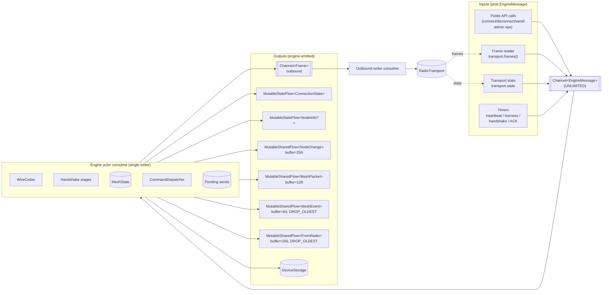

# Engine actor dataflow

This page diagrams the single-writer actor model that [ADR-002](../decisions/002-architecture.md) decides. ADR-002 holds the rationale and alternatives; this page is the visual reference.

## Component dataflow



How to read it:

- The boxes inside the engine are responsibilities of [`MeshEngine`](../../core/src/commonMain/kotlin/org/meshtastic/sdk/internal/MeshEngine.kt). `WireCodec`, `CommandDispatcher` and `MeshState` are their own types; the handshake stages and pending-send tracking live in `MeshEngine` itself.
- Every input funnels into one inbox, which the engine drains in order.
- Only the engine's own loop writes to a public flow. No transport coroutine calls `state.update { … }`.
- The outbound writer is a separate coroutine, so a slow socket never backpressures the engine. The `outbound` channel is `Channel.UNLIMITED` because the engine produces frames inside its own coroutine and must never suspend on its own output; the transport's `send` is what waits.
- Most storage writes run in coroutines the engine launches, so a slow `DeviceStorage` does not stall the inbox. `SqlDelightStorage` moves blocking driver calls off the caller's dispatcher ([`storage.md`](./storage.md)).

## Coroutine lifecycle

```mermaid
sequenceDiagram
    autonumber
    participant App as App / host
    participant Client as RadioClient
    participant Sup as SupervisorJob (per-client)
    participant Engine as Engine actor
    participant Reader as Frame reader
    participant Writer as Outbound writer
    participant HB as Heartbeat and liveness timers
    participant Trans as RadioTransport

    App->>Client: connect()
    Client->>Sup: launch under supervisor
    Sup->>Engine: launch
    Sup->>Reader: launch (collects transport.frames())
    Sup->>Writer: launch (drains outbound channel)

    Reader->>Trans: collect()
    Engine->>Trans: connect()
    Trans-->>Engine: TransportState.Connected
    Engine->>Engine: Stage 1, settle, Stage 2
    Engine-->>Client: connectionState = Connected
    Engine->>Trans: get_owner_request (passkey seed)
    Engine->>HB: launch 30 s heartbeat and liveness ticks

    loop steady state
        Trans-->>Reader: Frame
        Reader->>Engine: EngineMessage.FrameRx(Frame)
        Engine->>Engine: decode, mutate state, emit flows
        Engine->>Writer: outbound.send(Frame)
        Writer->>Trans: send(Frame)
        HB->>Engine: EngineMessage.HeartbeatTick / LivenessTick
        Engine->>Writer: outbound.send(HeartbeatFrame)
    end

    App->>Client: disconnect()
    Client->>Sup: cancel()
    Sup-->>Engine: cancellation
    Engine->>Engine: finally { resolve handles to Failed(Disconnected); flush storage; close transport }
    Engine-->>Client: connectionState = Disconnected
```

Notes on the sequence:

- Steps 2 to 5 happen synchronously in `connect()`, which then suspends until the session is `Connected` or throws on a terminal handshake failure.
- The reader is the only coroutine that collects `transport.frames()`; a second reader would race on framing state.
- The heartbeat runs on every transport; BLE can opt out with `Builder.disableBleHeartbeat()` (`protocol.md` §16).
- Cancelling the supervisor is the only shutdown path. `disconnect()` cancels it, so does cancelling the host scope, and a fatal transport error posts `EngineMessage.Disconnect(cause)` so the engine cancels it after updating `connectionState`.

## Backpressure

The engine is a single-writer actor between an unbounded inbox and a fan-out of bounded shared flows. It emits with `tryEmit` and never suspends on a subscriber.

| Surface | Capacity | When full | Rationale |
|---|---|---|---|
| `Channel<EngineMessage>` (inbox) | UNLIMITED | n/a | Producers (the frame reader, public API calls, timers) never block on the engine. |
| `Channel<Frame>` (outbound) | UNLIMITED | n/a | The engine produces frames inside its own coroutine; bounding the channel could deadlock it. |
| `nodes: SharedFlow<NodeChange>` | 256 | the change is dropped and `MeshEvent.PacketsDropped` is emitted | Each subscription starts from a fresh `Snapshot`, the consistency anchor. |
| `packets: SharedFlow<MeshPacket>` | 128 | the packet is dropped and `MeshEvent.PacketsDropped(Packets, 1)` is emitted | A loss is never silent. |
| `events: SharedFlow<MeshEvent>` | 64 | the oldest event is dropped | Events are advisory; observability never blocks the engine. |
| `fromRadio: Flow<FromRadio>` | 256 | the oldest envelope is dropped | A recorder or analyzer tap must never stall the engine. |
| `connection`, `ownNode` | StateFlow | newest wins | Lifecycle and identity are single values; intermediate states are noise. |

Unbounded with no suspension is deliberate. A bounded inbox that suspends would let a slow `events` collector stall the whole engine, admin replies and timers included; one that drops would lose `Connect` or `Disconnect`.

## EngineMessage variants

[`EngineMessage.kt`](../../core/src/commonMain/kotlin/org/meshtastic/sdk/internal/EngineMessage.kt) defines the sealed interface the engine `when`-matches over; there is no other entry point that mutates state.

| Group | Variants |
|---|---|
| Lifecycle | `Connect`, `Disconnect`, `ReconnectTick`, `ReconnectAttemptResult` |
| Inbound | `FrameRx`, `TransportStateChanged` |
| Outbound | `Send`, `CancelHandle`, `AdminFireAndForget`, `PostRpc` |
| Handshake | `HandshakeStage1SettleComplete`, `HandshakeHeartbeatSettleComplete`, `HandshakeTimeout` |
| Timers | `HeartbeatTick`, `LivenessTick`, `PresenceCheckTick`, `SendAckTimeout`, `PendingResponseTimeout`, `AdminTimeout` |

## Engine invariants

Every engine change keeps these. The handshake gates (session-ready only on the matching `config_complete_id`, pre-handshake frames dropped) are in [`handshake-fsm.md`](./handshake-fsm.md).

- Inbound dedup drops a `MeshPacket` whose `(from, to, channel, id)` matches one of the last 256 keys; a packet with `id == 0` or `from == 0` skips the check.
- A `MeshPacket` with no decoded payload never reaches `packets`, and the engine emits a `MeshEvent.ProtocolWarning` for it at most once a minute.
- An unsolicited admin message from the local device (`request_id == 0`) updates `channels` or `configBundle` in memory and in storage, and emits `MeshEvent.ExternalConfigChange`.
- Teardown clears the dedup set, admin sessions, pending sends (failed with `Disconnected`), pending admin requests (`NodeUnreachable`), `configBundle` and `channels`. An auto-reconnect cycle clears the dedup set, pending sends and `configBundle`, and keeps storage, `channels` and admin sessions.
- One outbound writer drains an unlimited `Channel<Frame>` in FIFO order, so concurrent sends never reorder on the wire.
- Mesh delivery retries belong to the device. The engine never re-sends a packet after `Sent`; `MessageHandle.retry()` and `retryWith` are new sends the caller starts.
- Admin requests are correlated by `request_id` and bounded by one `rpcTimeout`, 30 s by default.
- Storage is activated before `transport.connect()`.

## Anti-patterns (rejected in code review)

- A mutex on `MeshState`. The actor is the lock.
- A `launch { … }` inside the engine that mutates state. Deferred work posts an `EngineMessage`.
- Calling `transport.send` from a public method. Frames go through `outbound` from the engine.
- `StateFlow.update { … }` from outside the engine coroutine. Public flows are written only by the engine.

## Related

- ADR-002: full architecture rationale.
- ADR-005: public flow contracts (`NodeChange`, backpressure policy).
- [`handshake-fsm.md`](./handshake-fsm.md): the handshake stages this actor runs.
