# Handshake FSM

This page shows the engine's handshake state machine, the implementation of [`../protocol.md`](../protocol.md) §6 under [ADR-002](../decisions/002-architecture.md). [`MeshEngine`](../../core/src/commonMain/kotlin/org/meshtastic/sdk/internal/MeshEngine.kt) runs it; the `HandshakeStage` enum lives in [`EngineMessage.kt`](../../core/src/commonMain/kotlin/org/meshtastic/sdk/internal/EngineMessage.kt).

## States

The internal `HandshakeStage` enum has six values. The public `ConnectionState.Configuring` projection uses three `ConfigPhase` values (`Stage1`, `Settling`, `Stage2`).

| `HandshakeStage` | Meaning | Public projection |
|---|---|---|
| `Idle` | No connection attempted, or post-disconnect | `Disconnected` |
| `Stage1Draining` | `want_config_id = SPECIAL_NONCE_ONLY_CONFIG (69420)` posted; receiving the Stage 1 response stream (configs, channels, file_info, **no** nodes) | `Configuring(ConfigPhase.Stage1, p)` |
| `Stage1Settling` | `config_complete_id == 69420` received; settle window elapsing before the inter-stage heartbeat | `Configuring(ConfigPhase.Settling, 0.5f)` |
| `Stage2Draining` | Inter-stage `Heartbeat` flushed and `want_config_id = SPECIAL_NONCE_ONLY_NODES (69421)` posted; receiving Stage 2 (`OWN_NODEINFO` then `OTHER_NODEINFOS`; `FILEMANIFEST` short-circuits to empty) | `Configuring(ConfigPhase.Stage2, p)` |
| `SeedingSession` | Issuing `get_owner_request` to seed `session_passkey` for subsequent admin ops | `Configuring(ConfigPhase.Stage2, 0.95f)` |
| `Ready` | All flows live; heartbeat scheduler started | `Connected` |

A failure (`MeshtasticException.HandshakeTimeout`, a transport drop) resets `HandshakeStage` to `Idle`; the engine then projects `Reconnecting(cause, attempt)` or `Disconnected`. `progress` never decreases within one connect attempt and comes from received over expected envelope counts.

Timers: Stage 1 sends `want_config_id = 69420` once and times out at 20 s (`STAGE1_TIMEOUT_MS`); it never resends in-session (`protocol.md` §6 host-side rule 8). The settle waits are 100 ms each (`INTER_STAGE_SETTLE_MS`). Stage 2 times out when no frame arrives between two 30 s checks, or at 600 s in total (`STAGE2_PROGRESS_TICK_MS`, `STAGE2_HARD_CAP_MS`). Seeding waits 10 s (`SEED_TIMEOUT_MS`) for `get_owner_response`, then goes `Ready` without the passkey and emits `ProtocolWarning("session passkey seed timed out")`.

### Config-only sessions (`RadioClient.Builder.skipNodeDb`)

In a config-only connect the engine still runs Stage 1 and the settle heartbeat, then completes Stage 2 with a synthetic `config_complete_id = 69421` instead of requesting the NodeDB. No `want_config_id = 69421` is sent and `ConfigPhase.Stage2` is never projected. This is protocol-legal: firmware moves to `STATE_SEND_PACKETS` as soon as it emits `config_complete_id = 69420` (`protocol.md` §6). The node map then holds only the node's own `NodeInfo` (sent in Stage 1 as `STATE_SEND_OWN_NODEINFO`), and peers appear as they are heard. The config bundle, channels, session passkey, sending and receiving are unchanged.

## Transitions

```mermaid
stateDiagram-v2
    [*] --> Idle
    Idle --> Stage1Draining: connect() →\nTransportState.Connected →\nToRadio(want_config_id=69420) flushed
    Idle --> Idle: TransportState.Error\n(non-recoverable, surfaces as exception)

    Stage1Draining --> Stage1Draining: FromRadio (config / channel /\nfile_info envelopes)
    Stage1Draining --> Stage1Settling: FromRadio.config_complete_id=69420
    Stage1Draining --> Idle: HandshakeTimeout(Stage1Draining) /\ntransport drop

    Stage1Settling --> Stage2Draining: settle window elapsed →\nHeartbeat(nonce=n) flushed →\nToRadio(want_config_id=69421) flushed
    Stage1Settling --> Stage2Draining: skipNodeDb →\nno want_config_id=69421 sent;\nsynthetic config_complete_id=69421
    Stage1Settling --> Idle: HandshakeTimeout(Stage1Settling) /\ntransport drop

    Stage2Draining --> Stage2Draining: FromRadio.node_info\n(own then peers)
    Stage2Draining --> SeedingSession: FromRadio.config_complete_id=69421
    Stage2Draining --> Idle: HandshakeTimeout(Stage2Draining) /\ntransport drop

    SeedingSession --> Ready: AdminMessage.get_owner_response\n(session_passkey latched)
    SeedingSession --> Ready: SEED_TIMEOUT_MS elapsed\n(no passkey, ProtocolWarning)
    SeedingSession --> Idle: transport drop

    Ready --> Idle: disconnect() /\ntransport drop
    Ready --> [*]
```

### Stale frames (per protocol.md §6)

While `Idle`, which covers the gap between `transport.connect()` reaching `Connected` and the Stage 1 `want_config_id` going out, the engine drops every inbound frame, because stale `FromRadio` from an earlier PhoneAPI session would corrupt the early state. Once the Stage 1 nonce is on the wire, every frame is dispatched. Frames that arrive during the settle window are buffered (up to 64) and replayed after it, and mesh packets that arrive during the handshake are held (up to 64) until `Ready`. `queue_status` frames are discarded and `log_record` frames go straight to `RadioClient.deviceLogs`; neither is buffered.

### Heartbeat in handshake

One heartbeat goes out between the Stage 1 settle and the Stage 2 request, following the Android reference: it lets the node's task queue drain before NodeDB streaming. Its nonce comes from the engine's keep-alive counter, which starts at 2 and is never 0 or 1 (`protocol.md` §16). The 30 s periodic heartbeat starts on entry to `Ready`.

### Clock sync in handshake

With `autoSyncTimeOnConnect` on (the default), the first Stage 1 `my_info` triggers one `set_time_only` admin packet addressed to `my_info.my_node_num`. Firmware flushes its queued packets once Stage 1 ends and re-dates the ones it stamped without a clock when the clock turns valid (`MeshService::reconcilePendingRxTimes`), so packets still queued when the sync is read get a real `rx_time`. This is best effort: firmware reads input only between 100 ms write slices (`StreamAPI::runOncePart`, `STREAM_WRITE_BUDGET_MSEC`), so on a fast TCP link a short dump and its backlog can be written before the sync is read; over BLE and serial the sync usually lands mid-dump. Firmware fills `from` and the packet id.

### No wake heartbeat before Stage 1

The SDK sends the four `0x94` resync bytes on stream transports and nothing else before `want_config_id`; it sends no pre-handshake heartbeat on any transport. Firmware runs `powerFSM.trigger(EVENT_CONTACT_FROM_PHONE)` and refreshes `lastContactMsec` at the top of `PhoneAPI::handleToRadio` (`PhoneAPI.cpp:519-520`) for every `ToRadio` variant, so `want_config_id` itself is the contact event. `EVENT_CONTACT_FROM_PHONE` has a single transition, `stateDARK -> stateDARK` (`PowerFSM.cpp:470`), none from light sleep, and BLE writes reach `handleToRadio` through the same queue whatever the payload (`NimbleBluetooth.cpp:479-522`, `:256`).

## Failure transitions and reconnect

A failure always returns to `Idle`. Reconnecting is off by default: the engine projects `Disconnected` and the host decides what to do. `RadioClient.Builder.autoReconnect(...)` turns on a supervisor that reconnects after a recoverable `TransportState.Error`, with exponential backoff (by default 1 s initial, factor 2, capped at 60 s, ±20 % jitter, unlimited attempts; see `AutoReconnectConfig`). Each attempt is projected as `Reconnecting(cause, attempt)`.

Causes that DO NOT auto-reconnect:
- `MeshtasticException.FirmwareTooOld` (`DeviceMetadata.firmware_version` below `DeviceVersion.ABS_MIN_SUPPORTED`, 2.3.15; checked when the Stage 1 `metadata` frame arrives; firmware below `DeviceVersion.MIN_SUPPORTED`, 2.5.14, connects and emits one `MeshEvent.ProtocolWarning` per session; a blank or unparseable version only logs a warning). The connect throws it, the transport closes, and `ConnectionState` ends `Disconnected`.
- A non-recoverable transport error and an explicit `disconnect()`.
- `MeshtasticException.HandshakeTimeout(stage)`: the engine tears the session down; the host connects again.
- `MeshtasticException.StorageUnavailable(...)` from `StorageProvider.activate()`, which runs once per client before the handshake.

Causes that DO auto-reconnect:
- A recoverable `TransportState.Error`, and a read or write failure on the current link (`MeshtasticException.Transport`).

## Related

- `protocol.md` §6: the wire-level envelope sequence and the firmware's special nonces (69420, 69421).
- ADR-002: the actor model that owns this state machine.
- ADR-005: `ConnectionState` (no `DeviceSleep`); `Reconnecting` carries `cause`.
- [`protocol.md` §6 host-side rules](../protocol.md#host-side-rules): the 100 ms settle on each side of the inter-stage heartbeat, cited to Android's `HandshakeStateMachine`.
- [`protocol.md` §16](../protocol.md#16-heartbeat--queue-status): the heartbeat requirement per transport.
