# Handshake FSM

This page shows the engine's handshake state machine, the implementation of [`../protocol.md`](../protocol.md) §6 under [ADR-002](../decisions/002-architecture.md). [`MeshEngine`](../../core/src/commonMain/kotlin/org/meshtastic/sdk/internal/MeshEngine.kt) runs it; the `HandshakeStage` enum lives in [`EngineMessage.kt`](../../core/src/commonMain/kotlin/org/meshtastic/sdk/internal/EngineMessage.kt).

## States

The internal `HandshakeStage` enum has six values, `AwaitingLockdown` among them. The public `ConnectionState.Configuring` projection uses three `ConfigPhase` values (`Stage1`, `Settling`, `Stage2`).

| `HandshakeStage` | Meaning | Public projection |
|---|---|---|
| `Idle` | No connection attempted, or post-disconnect | `Disconnected`; `Disconnecting` while a `disconnect()` tears the session down |
| `Stage1Draining` | `want_config_id = SPECIAL_NONCE_ONLY_CONFIG (69420)` posted; receiving the Stage 1 response stream (configs, channels, file_info, **no** nodes) | `Configuring(ConfigPhase.Stage1, p)` |
| `Stage1Settling` | `config_complete_id == 69420` received; settle window elapsing before the inter-stage heartbeat | `Configuring(ConfigPhase.Settling, 0.5f)` |
| `Stage2Draining` | Inter-stage `Heartbeat` flushed and `want_config_id = SPECIAL_NONCE_ONLY_NODES (69421)` posted; receiving Stage 2 (`OWN_NODEINFO` then `OTHER_NODEINFOS`; `FILEMANIFEST` short-circuits to empty) | `Configuring(ConfigPhase.Stage2, p)` |
| `Ready` | All flows live; heartbeat scheduler started; `get_owner_request` sent to seed `session_passkey` | `Connected` |

A failure (`MeshtasticException.HandshakeTimeout`, a transport drop) resets `HandshakeStage` to `Idle`; the engine then projects `Reconnecting(cause, attempt, retryAt)`, `Failed(cause)` or `Disconnected`. `progress` never decreases within one connect attempt and comes from received over expected envelope counts.

Timers: Stage 1 sends `want_config_id = 69420` once and never resends in-session (`protocol.md` §6 host-side rule 8). It times out after 20 s without a frame of its dump (`STAGE1_TIMEOUT_MS`), measured from the request and re-armed by every frame from `my_info` on, or at 200 s in total (`STAGE1_HARD_CAP_MS`). A `rebooted` frame before `my_info` ends the attempt like a reboot mid-handshake unless `my_info` follows within 2 s (`STAGE1_REBOOT_GRACE_MS`): firmware before 2.8 writes it from the serial console at boot, before it reads input, so the request went to the previous boot. A completion before `my_info` is stale and dropped. The settle waits are 100 ms each (`INTER_STAGE_SETTLE_MS`). Stage 2 times out when no frame arrives between two 30 s checks, or at 600 s in total (`STAGE2_PROGRESS_TICK_MS`, `STAGE2_HARD_CAP_MS`). The passkey seed goes out at the Stage 2 completion and the session is `Ready` at once: firmware starts replaying stored positions and telemetry right after that completion, more packets than the handshake buffer holds. A `get_owner_response` whose `request_id` is the seed's packet id latches the local passkey whenever it arrives and is not offered on `packets`; with none in 10 s (`SEED_TIMEOUT_MS`) the engine emits `ProtocolWarning("session passkey seed timed out")`. Local admin writes need no passkey.

### Config-only sessions (`RadioClient.Builder.skipNodeDb`)

In a config-only connect the engine still runs Stage 1 and the settle heartbeat, then completes Stage 2 with a synthetic `config_complete_id = 69421` instead of requesting the NodeDB. No `want_config_id = 69421` is sent and `ConfigPhase.Stage2` is never projected. This is protocol-legal: firmware moves to `STATE_SEND_PACKETS` as soon as it emits `config_complete_id = 69420` (`protocol.md` §6). The node map then holds only the node's own `NodeInfo` (sent in Stage 1 as `STATE_SEND_OWN_NODEINFO`), and peers appear as they are heard. The config bundle, channels, session passkey, sending and receiving are unchanged.

## Transitions

```mermaid
stateDiagram-v2
    [*] --> Idle
    Idle --> Stage1Draining: connect() →\nTransportState.Connected →\nToRadio(want_config_id=69420) flushed
    Idle --> Idle: TransportState.Error\n(non-recoverable, surfaces as exception)

    Stage1Draining --> Stage1Draining: FromRadio (config / channel /\nfile_info envelopes)
    Stage1Draining --> Stage1Settling: FromRadio.config_complete_id=69420
    Stage1Draining --> Idle: HandshakeTimeout(Stage1Draining) /\ntransport drop

    Stage1Settling --> Stage2Draining: settle window elapsed →\nHeartbeat(nonce=n) flushed →\nToRadio(want_config_id=69421) flushed
    Stage1Settling --> Stage2Draining: skipNodeDb →\nno want_config_id=69421 sent;\nsynthetic config_complete_id=69421
    Stage1Settling --> Idle: HandshakeTimeout(Stage1Settling) /\ntransport drop

    Stage2Draining --> Stage2Draining: FromRadio.node_info\n(own then peers)
    Stage2Draining --> Ready: FromRadio.config_complete_id=69421\n(get_owner_request sent)
    Stage2Draining --> Idle: HandshakeTimeout(Stage2Draining) /\ntransport drop


    Ready --> Idle: disconnect() /\ntransport drop
    Ready --> [*]
```

### Stale frames (per protocol.md §6)

While `Idle`, which covers the gap between `transport.connect()` reaching `Connected` and the Stage 1 `want_config_id` going out, the engine drops every inbound frame, because stale `FromRadio` from an earlier PhoneAPI session would corrupt the early state. Once the Stage 1 nonce is on the wire, every frame is dispatched. Frames that arrive during either settle window, before or after the inter-stage heartbeat, are buffered (up to 128) and replayed when that window ends, and mesh packets that arrive during the handshake are held (up to 128) until `Ready`, with the session stream's copies of handshake events among them in receive order. Both hold a full firmware to-phone queue: meshtasticd keeps 100 packets by default (`PortduinoGlue.h`), radios 8 to 32 (`mesh-pb-constants.h`). `queue_status` frames are discarded and `log_record` frames go straight to `RadioClient.deviceLogs`; neither is buffered.

### Heartbeat in handshake

One heartbeat goes out between the Stage 1 settle and the Stage 2 request, following the Android reference: it lets the node's task queue drain before NodeDB streaming. Its nonce comes from the engine's keep-alive counter, which starts at 2 and is never 0 or 1 (`protocol.md` §16). The 30 s periodic heartbeat starts on entry to `Ready`, or to `AwaitingLockdown`, which also sends one at once. Its reply, a `QueueStatus` for packet id 0 from firmware 2.7.4 on, arms the liveness watchdog ([`protocol.md` §16](../protocol.md#16-heartbeat--queue-status)).

### Clock sync in handshake

With `autoSyncTimeOnConnect` on (the default), the first Stage 1 `my_info` triggers one `set_time_only` admin packet addressed to `my_info.my_node_num`. Firmware flushes its queued packets once Stage 1 ends and re-dates the ones it stamped without a clock when the clock turns valid (`MeshService::reconcilePendingRxTimes`), so packets still queued when the sync is read get a real `rx_time`. This is best effort: firmware reads input only between 100 ms write slices (`StreamAPI::runOncePart`, `STREAM_WRITE_BUDGET_MSEC`), so on a fast TCP link a short dump and its backlog can be written before the sync is read; over BLE and serial the sync usually lands mid-dump. Firmware fills `from` and the packet id.

### No wake heartbeat before Stage 1

The SDK sends the four `0x94` resync bytes on stream transports and nothing else before `want_config_id`; it sends no pre-handshake heartbeat on any transport. Firmware runs `powerFSM.trigger(EVENT_CONTACT_FROM_PHONE)` and refreshes `lastContactMsec` at the top of `PhoneAPI::handleToRadio` (`PhoneAPI.cpp:519-520`) for every `ToRadio` variant, so `want_config_id` itself is the contact event. `EVENT_CONTACT_FROM_PHONE` has a single transition, `stateDARK -> stateDARK` (`PowerFSM.cpp:470`), none from light sleep, and BLE writes reach `handleToRadio` through the same queue whatever the payload (`NimbleBluetooth.cpp:479-522`, `:256`).

## Failure transitions and reconnect

A failure always returns to `Idle`. Reconnecting is on by default: a supervisor owns it, unless the builder gets `AutoReconnectConfig.Disabled`, in which case after a recoverable failure the engine projects `Disconnected` and the host decides what to do (`FirmwareTooOld` and a non-recoverable transport error still end in `Failed`). The supervisor retries with exponential backoff (by default 1 s initial, factor 2, capped at 60 s, ±20 % jitter, unlimited attempts; see `AutoReconnectConfig`). Each wait is projected as `Reconnecting(cause, attempt, retryAt)`, or as `DeviceSleeping` when the drop was a power-saving device sleeping; `retryAt` is `null` while the attempt runs.

An attempt runs off the actor: it disconnects the previous transport, waits for its frame reader to finish, asks the `RadioTransportProvider` for a transport, may wait there, and calls `connect()`, holding the lockdown write lock throughout so a queued credential write never reaches the next link. The actor installs what the provider returned as the transport for that attempt, with a state observer of its own; the outbound writer sends only on the transport of the current `receiveGeneration`, so nothing queued for one link reaches the next. A failed `connect()` on a transport that also reports `TransportState.Error(recoverable = false)` is terminal. Transport state errors count only while a link is up: a failed attempt reports through its outcome, and a replaced transport's late updates are ignored.

`attempt` and the backoff reset once a session has stayed `Connected` for `stableAfter` (at once with the default `Duration.ZERO`). `sessionEvents` emits `Ended` for the old session before the engine publishes `Reconnecting`; the next session's `Ready` carries the next `sessionId`.

Causes that end in `Failed(cause)` and are not retried, with auto-reconnect on or off:
- `MeshtasticException.FirmwareTooOld` (`DeviceMetadata.firmware_version` below `DeviceVersion.ABS_MIN_SUPPORTED`, 2.3.15; checked when the Stage 1 `metadata` frame arrives; firmware below `DeviceVersion.MIN_SUPPORTED`, 2.5.14, connects and emits one `MeshEvent.ProtocolWarning` per session; a blank or unparseable version only logs a warning). The connect throws it and the transport closes.
- A `TransportState.Error` with `recoverable = false`, from a live link or reported alongside a failed `connect()`.

With auto-reconnect on, also `maxAttempts` attempts since the last stable session, and `maxHandshakeRecoveries` handshake restarts in a row; `Failed` carries the last cause.

Causes that end in `Disconnected` and are not retried: an explicit `disconnect()`, `MeshtasticException.StorageUnavailable(...)` from `StorageProvider.activate()`, which runs once per `connect()` before the handshake, and, with auto-reconnect off, everything below.

Causes that auto-reconnect when it is on:
- A recoverable `TransportState.Error`, a read or write failure on the current link (`MeshtasticException.Transport`), and a failed first `connect()`.
- `FromRadio.rebooted` (`MeshEvent.DeviceRebooted` is still emitted).
- Session restarts, counted against `maxHandshakeRecoveries`: `MeshtasticException.HandshakeTimeout(stage)`, the liveness watchdog (`Transport("liveness timeout")`), a node database refresh that stalls, a handshake protocol error such as a `config_complete_id` matching neither nonce, and a `sessionEvents` overflow while a collector is running (`Transport("Session receive overflowed in session n")`; three in a row fail when `maxHandshakeRecoveries` is `null`). A session that reached `Ready` and then ended any other way resets the count; an overflow does not. On an overflow the session stream is replaced: its collector gets `RadioSessionOverflowException`, and the next collection starts with that session's `Ended`.

## Related

- `protocol.md` §6: the wire-level envelope sequence and the firmware's special nonces (69420, 69421).
- ADR-002: the actor model that owns this state machine.
- ADR-005: `ConnectionState`; `Reconnecting` carries `cause`, `Failed` carries the terminal cause.
- [`protocol.md` §6 host-side rules](../protocol.md#host-side-rules): the 100 ms settle on each side of the inter-stage heartbeat, cited to Android's `HandshakeStateMachine`.
- [`protocol.md` §16](../protocol.md#16-heartbeat--queue-status): the heartbeat requirement per transport.
