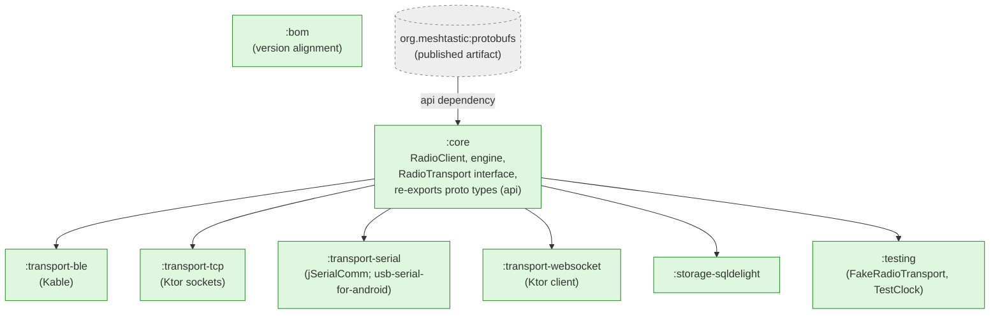
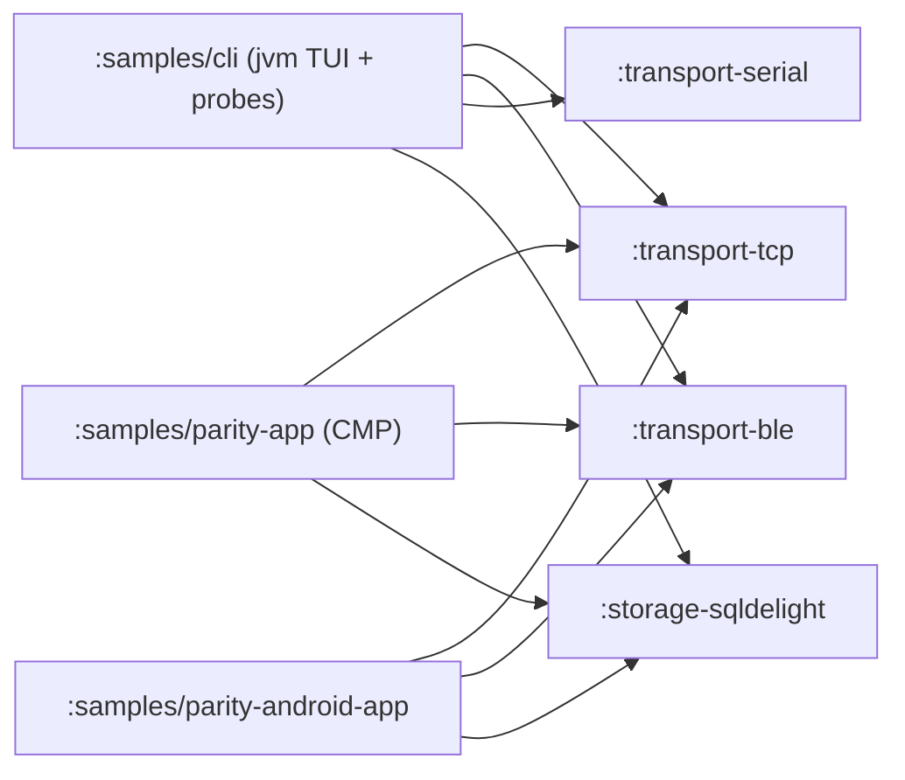
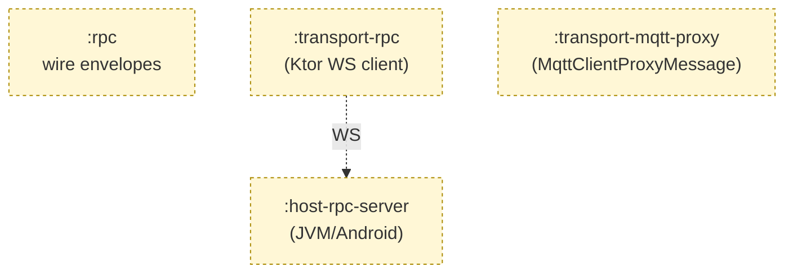

# Module dependency graph

This page shows the module dependency graph that [ADR-006](../decisions/006-multi-module-rationale.md) decides. The Gradle build (`:core:verifyModuleBoundary`) and detekt enforce it.

`RadioTransport`, `Frame` and `TransportIdentity` live in `:core`; there is no `:transport-api` module. There is no `:proto` module either: protobuf types come from the published `org.meshtastic:protobufs` artifact, which `:core` re-exports through `api(...)`. Transport modules depend only on `:core`, for the interface and, transitively, the wire types.

## Library modules

Read an arrow as "is a dependency of": `:core → :transport-ble` means `:transport-ble` depends on `:core`. The wire types reach every module through `:core`'s `api(org.meshtastic:protobufs)` declaration; only `:core` names the artifact.

### Hard rules (Gradle + detekt enforced)

1. `:core` has no in-tree project dependencies (`:core:verifyModuleBoundary`). It defines the `RadioTransport` interface and re-exports the `org.meshtastic:protobufs` types through `api`.
2. Transport modules depend on `:core` for `RadioTransport`, `Frame` and `TransportIdentity`, and the wire types transitively. A transport is wired into a `RadioClient` with `Builder.transport(...)`.
3. Storage modules depend on `:core` for `StorageProvider` and `DeviceStorage`, and the wire types transitively.
4. `:testing` can depend on anything published.
5. `:samples/*` can depend on anything, nothing depends on them, and they are not published.
6. `:bom` is a leaf: it lists every published artifact's coordinate and compiles to a Maven BOM only.

## Per-target compile matrix

| Module | android | jvm | iosArm64 | iosX64 | iosSimulatorArm64 | js | wasmJs |
|---|:---:|:---:|:---:|:---:|:---:|:---:|:---:|
| `:core` | ✓ | ✓ | ✓ | ✓ | ✓ | ✓ | ✓ |
| `:transport-ble` | ✓ | ✓ | ✓ | ✓ | ✓ | — | — |
| `:transport-tcp` | ✓ | ✓ | ✓ | ✓ | ✓ | — | — |
| `:transport-websocket` | ✓ | ✓ | ✓ | ✓ | ✓ | ✓ | ✓ |
| `:transport-serial` | ✓ | ✓ | common only | common only | common only | — | — |
| `:storage-sqldelight` | ✓ | ✓ | ✓ | ✓ | ✓ | — | — |
| `:testing` | ✓ | ✓ | ✓ | ✓ | ✓ | ✓ | ✓ |
| `:bom` | n/a (Maven BOM only) | | | | | | |

- iOS: the iOS targets of `:transport-serial` carry only the common code (`SerialFrameAssembler` and the port types), with no port access, because iOS exposes no USB serial without an MFi accessory and its own framing. BLE, TCP and WebSocket work on iOS.
- Web: `:core`, `:testing` and `:transport-websocket` publish Kotlin/JS and Kotlin/Wasm klibs (`js`, `wasmJs`) through the `meshtastic.js.library` convention plugin; the WebSocket module's one platform file is shared between them in `webMain`. Web consumers compile them into their own bundle. `:transport-websocket` reaches a node over its WebSocket phone API, or the consumer supplies its own `RadioTransport` (Web Bluetooth, Web Serial). Both targets run their tests on Node.js only.
- JVM: BLE runs on Kable's JVM backend on macOS, Linux and Windows; treat it as best-effort on desktop OSes. Serial uses jSerialComm.
- Android: `:transport-serial` offers two backends from one artifact: `AndroidSerialPorts` on jSerialComm (bundled, [ADR-010](../decisions/010-jserialcomm-jvm-serial.md)) and `AndroidUsbSerialPorts` on usb-serial-for-android (`compileOnly`; the host adds the library and the JitPack repository, [ADR-016](../decisions/016-usb-serial-for-android-backend.md)).

## Sample apps (out of band, not published)

`:samples/cli` is a JVM sample that exercises the TCP, BLE and serial transports and persistent storage from one entry point: a Mosaic-rendered TUI dashboard (`tui`), `scan` and `probe` subcommands per transport that serve as connection-robustness regression harnesses, and `conformance` ([`../manual-tests.md`](../manual-tests.md)).

`:samples/parity-app` is a Compose Multiplatform reference app for Android and desktop (JVM). `:samples/parity-android-app` is a minimal Android-only companion for the Android integration path (permissions, foreground service, lifecycle). There is no iOS sample.

Sample scope and acceptance criteria live in [`../samples.md`](../samples.md).

## Roadmap (post-1.0)

These modules do not exist yet. The remote-RPC ones are designed in [`../future/wasm-rpc-roadmap.md`](../future/wasm-rpc-roadmap.md); `:transport-mqtt-proxy` has no design ([`../roadmap.md`](../roadmap.md) R-11).

| Module | Targets (planned) | Depends on | Roadmap link |
|---|---|---|---|
| `:rpc` | all incl. `wasmJs` | `org.meshtastic:protobufs` | wasm-rpc-roadmap |
| `:transport-rpc` | all incl. `wasmJs` | `:rpc`, `org.meshtastic:protobufs` (NOT `:core`) | wasm-rpc-roadmap |
| `:host-rpc-server` | jvm, android | `:core`, `:rpc` | wasm-rpc-roadmap |
| `:transport-mqtt-proxy` | android, jvm, ios | `:core`, `org.meshtastic:mqtt-client-core` | roadmap R-11 |

## Related

- ADR-006: module rationale.
- ADR-015: proto sourcing from the published `org.meshtastic:protobufs` artifact.
- ADR-002: engine architecture, which justifies the `:core` to transport boundary.
- ADR-003: tooling, which justifies the library each transport module wraps.
- [ADR-017](../decisions/017-web-targets.md): the `js` and `wasmJs` targets running the engine in-process.
- `transport-comparison.md`: feature × transport matrix (TCP, BLE, serial, WebSocket), OS support, and selection guidance.
- [`../future/wasm-rpc-roadmap.md`](../future/wasm-rpc-roadmap.md): the post-1.0 remote-RPC architecture.
