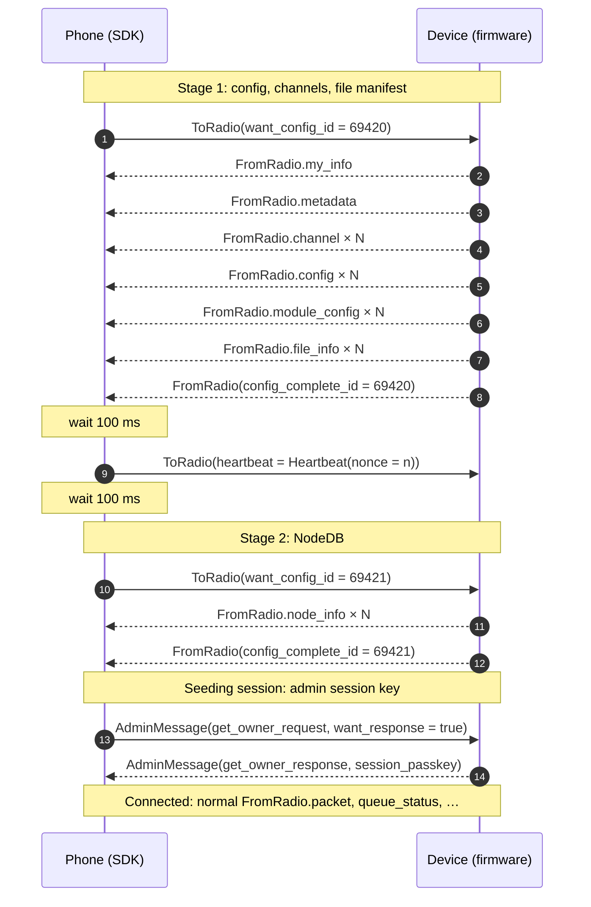

# Meshtastic PhoneAPI wire protocol reference

This page describes the PhoneAPI, the protocol between a Meshtastic node and a client, as the SDK implements it. It is written for anyone building a clean-room client.

Sources:

1. [`meshtastic/protobufs`](https://github.com/meshtastic/protobufs): message structure.
2. [`meshtastic/firmware`](https://github.com/meshtastic/firmware): node behavior. GPL-3.0; never copy code.
3. [`meshtastic/Meshtastic-Android`](https://github.com/meshtastic/Meshtastic-Android) and [`meshtastic/Meshtastic-Apple`](https://github.com/meshtastic/Meshtastic-Apple): client references. GPL-3.0; never copy code.
4. [`meshtastic/meshtastic`](https://github.com/meshtastic/meshtastic), the documentation site at https://meshtastic.org: intent and rationale. GPL-3.0; never copy text.

When sources conflict, firmware wins on behavior, then protobufs on structure, then the documentation site, then the clients. Conflicts are flagged inline.

---

## Table of contents

1. [Transport overview](#1-transport-overview)
2. [Stream framing (TCP & Serial)](#2-stream-framing-tcp--serial)
3. [BLE GATT framing](#3-ble-gatt-framing)
4. [HTTP API framing](#4-http-api-framing) (and WebSocket)
5. [PhoneAPI envelopes](#5-phoneapi-envelopes-toradio--fromradio)
6. [Handshake state machine](#6-handshake-state-machine)
7. [MeshPacket structure](#7-meshpacket-structure)
8. [PortNums and per-port payloads](#8-portnums--per-port-payloads)
9. [Channel encryption (AES-CTR)](#9-channel-encryption-aes-ctr)
10. [PKI direct messages (X25519 + AES-CCM)](#10-pki-direct-messages-x25519--aes-ccm)
11. [Routing, ACK, retry semantics](#11-routing-ack-retry-semantics)
12. [Outbound queue & send lifecycle](#12-outbound-queue--send-lifecycle)
13. [Admin protocol & session passkey](#13-admin-protocol--session-passkey)
14. [MQTT proxy mode](#14-mqtt-proxy-mode)
15. [File transfer (XModem)](#15-file-transfer-xmodem)
16. [Heartbeat & queue status](#16-heartbeat--queue-status)
17. [Channels, roles, regions, presets](#17-channels-roles-regions-presets)
18. [Constants & magic numbers](#18-constants--magic-numbers)
19. [Implementation pitfalls (read this)](#19-implementation-pitfalls-read-this)

---

## 1. Transport overview

The PhoneAPI runs over five transports, all carrying the same stream of `ToRadio` and `FromRadio` protobuf envelopes:

| Transport | Framing | Default endpoint | Notes |
|---|---|---|---|
| TCP | 4-byte stream framing (§2) | port 4403 | One client at a time. 15-minute idle close (§1A). |
| Serial (USB-CDC) | 4-byte stream framing (§2) | 115200 8N1, no flow control | Same wire format as TCP. Debug text and protobuf frames share the port. |
| BLE | GATT (§3), no stream framing | service `6BA1B218-15A8-461F-9FA8-5DCAE273EAFD` | Each read of `fromradio` returns one `FromRadio`, or nothing when the queue is drained. Each write to `toradio` carries one `ToRadio`. |
| HTTP | Bare protobuf in the HTTP body (§4) | port 80 (HTTP), 443 (HTTPS) | `PUT /api/v1/toradio`, `GET /api/v1/fromradio?all={bool}`. HTTPS uses a self-signed certificate. The SDK has no HTTP transport. |
| WebSocket | One protobuf per binary message (§4) | `/api/v1/ws` on the node's web server | One client at a time. Needs firmware support that is not merged yet. |

The SDK implements framing per transport behind the transport-agnostic `RadioTransport` interface.

### § 1A. TCP idle timeout behavior

Firmware closes a TCP connection after 15 minutes (`TCP_IDLE_TIMEOUT_MS` in `firmware:src/mesh/api/ServerAPI.cpp`) with no `ToRadio` from the client. Traffic from the node does not reset the timer. The timeout is fixed in firmware and applies to TCP only.

When it fires, firmware closes the socket, the transport reads end-of-stream and reports `TransportState.Error(recoverable = true)`, and the session ends.

The SDK sends a `ToRadio.heartbeat` every 30 s once the session is `Connected` (§16), so an SDK session over TCP never reaches the timeout. Reconnecting after any drop is off by default: `RadioClient.Builder.autoReconnect(...)` turns on the engine's backoff supervisor, and [`consumer-guides/error-handling.md`](consumer-guides/error-handling.md#reconnecting) covers reconnecting with and without it.

---

## 2. Stream framing (TCP & Serial)

TCP and serial use this framing. BLE does not; it relies on GATT message boundaries.

### Frame layout

```
+------+------+----------+----------+==================+
| 0x94 | 0xC3 |   LEN_HI |   LEN_LO |  protobuf bytes  |
+------+------+----------+----------+==================+
   1B     1B       1B         1B          0..512 bytes
```

- **`START1` = `0x94`** (`firmware:src/mesh/StreamAPI.cpp:7`)
- **`START2` = `0xC3`** (`firmware:src/mesh/StreamAPI.cpp:8`)
- **Length** = big-endian uint16 (`high << 8 | low`), counting only the protobuf payload bytes that follow, not the 4-byte header.
- **Maximum payload** = `MAX_TO_FROM_RADIO_SIZE` = **512 bytes** (`firmware:src/mesh/PhoneAPI.h:13`). Any frame whose declared length exceeds 512 must be discarded and resync started.

### Resync algorithm (mandatory)

The host MUST be tolerant to garbage on the wire, especially on serial (a device may have just emitted boot text). The firmware itself implements a strict resync state machine; the host SDK must do the same on the receive side.

```
state := SCAN_FOR_START1
loop on each received byte b:
  case state:
    SCAN_FOR_START1:
      if b == 0x94: state := EXPECT_START2
    EXPECT_START2:
      if b == 0xC3: state := READ_LEN_HI
      else if b == 0x94: state := EXPECT_START2  // double-94 still valid
      else:               state := SCAN_FOR_START1
    READ_LEN_HI:
      hi := b; state := READ_LEN_LO
    READ_LEN_LO:
      len := (hi << 8) | b
      if len > 512:
        state := SCAN_FOR_START1  // bogus length, resume scanning
      else:
        bytesRemaining := len; state := READ_PAYLOAD
    READ_PAYLOAD:
      append b to buffer
      if buffer.size == len:
        try parse FromRadio from buffer
          on success: emit FromRadio; clear; state := SCAN_FOR_START1
          on failure: log warning; clear; state := SCAN_FOR_START1
```

A corrupt length byte can swallow up to 512 following bytes before the next resync. Property-test the codec with random byte streams to confirm bounded recovery.

On serial, the bytes between frames are the node's debug text. The SDK's serial transports hand complete text lines to an optional callback (`SerialFrameAssembler.onTextLine`, and the `open` overloads that take one); a `0x94` inside UTF-8 text that does not start a frame stays in the line.

### Wake bytes (reconnect hygiene, stream transports only)

On TCP and serial connect, a client should write four `0x94` (`START1`) bytes after the link comes up and before the first `ToRadio.want_config_id`. A healthy firmware framer treats them as no-ops (the resync state machine stays in `EXPECT_START2` on repeated `START1`). A framer left mid-frame by an unclean disconnect is reset by them instead of spending most of the Stage 1 timeout (§6) on a phantom payload length.

The SDK's TCP and serial transports send them, as does the Meshtastic-Android reference (`StreamFrameCodec.WAKE_BYTES`). BLE and WebSocket have no stream framing and do not need them.

### Encode side

```
emit 0x94, 0xC3, (payload.size >> 8) & 0xFF, payload.size & 0xFF, ...payload
```

A payload over 512 bytes is rejected with a programmer error, never split.

---

## 3. BLE GATT framing

BLE uses GATT message boundaries directly. The phone subscribes to a notification characteristic and drains a read characteristic until empty.

### Service & characteristics (cross-validated firmware ↔ Apple)

| Role | UUID | Properties |
|---|---|---|
| **Mesh service** | `6BA1B218-15A8-461F-9FA8-5DCAE273EAFD` | — |
| `fromradio` | `2C55E69E-4993-11ED-B878-0242AC120002` | **READ**: one `FromRadio` per read; an empty read means the queue is drained |
| `toradio` | `F75C76D2-129E-4DAD-A1DD-7866124401E7` | **WRITE** (acknowledged): one `ToRadio` per write. Firmware declares `CHR_PROPS_WRITE` only (`NRF52Bluetooth.cpp`, and the NimBLE equivalent), so strict stacks such as Android with Kable refuse write-without-response. Verified against real nodes. |
| `fromnum` | `ED9DA18C-A800-4F66-A670-AA7547E34453` | **NOTIFY** + **READ**: 4-byte little-endian counter that increments whenever the node queues data on `fromradio` |
| `logradio` (optional, current) | `5A3D6E49-06E6-4423-9944-E9DE8CDF9547` | **NOTIFY** + **READ**: device log lines, informational only |
| `logradio` (optional, legacy) | `6C6FD238-78FA-436B-AACF-15C5BE1EF2E2` | **NOTIFY** + **READ**: legacy log characteristic. Subscribe to whichever is advertised. |

The node also exposes the standard Battery Service `0x180F` with characteristic `0x2A19`. The SDK reads `logradio` only when asked, through `BleTransport.deviceLogs()`.

### The drain protocol (CRITICAL)

```
on connect:
  subscribe to fromnum (notify)
  subscribe to fromradio (notify)  // some firmware variants notify here too
  trigger initial drain

on fromnum notification (or any wake signal):
  if isDraining: set needsRedrain := true; return
  isDraining := true
  loop:
    bytes := read(fromradio)
    if bytes.isEmpty(): break    // queue exhausted
    parse bytes as FromRadio; deliver to upper layer
  isDraining := false
  if needsRedrain: needsRedrain := false; goto drain entry
```

> **Pitfall**: `fromnum` is a wake signal, not a count of waiting messages. Always drain by reading until empty.

While the node is in any `STATE_SEND_*` state other than `STATE_SEND_PACKETS`, an empty read blocks on some firmware variants: the node waits to push the next config message instead of returning empty. Treat it as backpressure and do not poll in a tight loop.

### MTU

- The node requests MTU 517 on ESP32-S3 and ESP32-C6, which fits a 512-byte payload plus ATT overhead.
- The fallback when negotiation fails is 23, the BLE minimum.
- Each `toradio` write has to fit the negotiated MTU, so query it rather than assume it. The SDK's Android transport requests 517 after every link establishment.

### Bonding and pairing

- Pairing uses numeric comparison with a 6-digit PIN, which the node shows on its display if it has one and logs. `config.bluetooth.fixed_pin` sets a static PIN.
- The OS manages pairing and bonding. The SDK surfaces it as `TransportState.Bonding` and does not drive it, except for the opt-in bond-first step in `BleResilience` on Android.
- nRF52 platforms pair through `NRF52Bluetooth.cpp`; ESP32 platforms use NimBLE.

---

## 4. HTTP API framing

ESP32 nodes with Wi-Fi or Ethernet expose a REST API used by browser clients such as the web client at `client.meshtastic.org`. Each request carries one envelope as a binary protobuf body, with no `0x94 0xC3` stream framing.

### Endpoints

| Method | Path | Body | Response |
|---|---|---|---|
| `PUT` | `/api/v1/toradio` | One `ToRadio` protobuf, binary | `204 No Content` on success |
| `GET` | `/api/v1/fromradio` | (none) | One `FromRadio` protobuf, binary; empty body when queue drained |
| `GET` | `/api/v1/fromradio?all=true` | (none) | Concatenation of all queued `FromRadio` protobufs; the host parses sequentially using protobuf length-delimited semantics or by stopping at end-of-body |
| `OPTIONS` | `/api/v1/toradio` | (none) | `204 No Content` (CORS / connection validation) |

### Content type

- Request and response `Content-Type: application/x-protobuf`.
- Optional response header `X-Protobuf-Schema` may carry a URI to the schema for documentation / discovery.

### Transport

- HTTP on port **80**, HTTPS on port **443**. Devices serve their own **self-signed certificate**; browsers require manual trust. The hosted web client at `client.meshtastic.org` is HTTPS-only and so requires the device's HTTPS endpoint be trusted out-of-band.
- There is no authentication; network access is the trust boundary. A node exposed beyond a trusted network needs gateway-level authentication in front of it.
- The HTTP API is **stateless from the device's perspective**: there is no equivalent of TCP's "single concurrent connection" lock; multiple GET pollers can share a queue (though each `FromRadio` is consumed once).

### Polling pattern

The SDK does not implement an HTTP transport. An HTTP client polls `GET /api/v1/fromradio?all=true`, typically every 1 to 5 seconds. An empty body means the queue is drained.

`meshtastic.js` (https://github.com/meshtastic/js) is the reference TypeScript client. A Kotlin HTTP transport would be its own module (see [`./future/wasm-rpc-roadmap.md`](./future/wasm-rpc-roadmap.md)), not part of `transport-tcp`, because the framing differs.

> **Pitfall**: do not prepend `0x94 0xC3` headers to HTTP bodies. HTTP carries a bare protobuf with no length prefix; `Content-Length` does that job.

### WebSocket

Firmware's WebSocket phone API is served at `/api/v1/ws` on the node's web server: `ws://` or `wss://`, ports 80 and 443 on ESP32. Support is in unmerged firmware pull requests (#12412 for ESP32, #12413 for meshtasticd, #12414 for a plain `HTTPPort` on meshtasticd).

- Each binary message carries one `ToRadio` or `FromRadio` with no stream header. Text messages are ignored.
- No subprotocol is offered; meshtasticd answers a `Sec-WebSocket-Protocol` header with 400.
- The node serves one client at a time. A newer client displaces the old one with close code 4001; a message over 512 bytes closes with 1009; 1013 means the node is out of memory.

The SDK's `:transport-websocket` implements this; its [Module.md](../transport-websocket/Module.md) has the close-code mapping, the contested-slot and 1013 backoff behavior, and the browser constraints.

---

## 5. PhoneAPI envelopes (`ToRadio` / `FromRadio`)

All transports carry exactly one `FromRadio` per inbound message and one `ToRadio` per outbound message. These are oneof-based protobuf wrappers defined in `mesh.proto`.

### `ToRadio` (phone → device)

```protobuf
message ToRadio {
  oneof payload_variant {
    MeshPacket packet              = 1;  // App-layer outbound packet (text, position, telemetry, admin, etc.)
    uint32     want_config_id      = 3;  // Triggers the config handshake (see §6)
    bool       disconnect          = 4;  // Phone politely tells device it is dropping the link
    XModem     xmodemPacket        = 5;  // File transfer (see §15)
    MqttClientProxyMessage mqttClientProxyMessage = 6;  // (see §14)
    Heartbeat  heartbeat           = 7;  // Liveness ping (see §16)
  }
}
```

### `FromRadio` (device → phone)

```protobuf
message FromRadio {
  uint32 id = 1;  // Sequential per-session
  oneof payload_variant {
    MeshPacket  packet                  = 2;  // App-layer inbound packet
    MyNodeInfo  my_info                 = 3;  // Phone's view of THIS node (config handshake)
    NodeInfo    node_info               = 4;  // Other-node info from NodeDB (config handshake)
    Config      config                  = 5;  // Config sub-message (config handshake)
    LogRecord   log_record              = 6;  // Device log line (stream transports, only with security.debug_log_api_enabled); RadioClient.deviceLogs
    uint32      config_complete_id      = 7;  // Terminator: handshake complete (echoes want_config_id)
    bool        rebooted                = 8;  // Device booted; treat as forced disconnect
    ModuleConfig moduleConfig           = 9;  // ModuleConfig sub-message (config handshake)
    Channel     channel                 = 10; // Channel definition (config handshake)
    QueueStatus queueStatus             = 11; // Outbound queue accounting (see §12, §16)
    XModem      xmodemPacket            = 12; // File transfer (see §15)
    DeviceMetadata metadata             = 13; // Firmware version, hw model, role, hasPKC, etc. (config handshake)
    MqttClientProxyMessage mqttClientProxyMessage = 14; // (see §14)
    FileInfo    fileInfo                = 15; // File system manifest entry (config handshake)
    ClientNotification clientNotification = 16; // User-facing notification
    DeviceUIConfig deviceuiConfig       = 17; // UI customization payload
    LockdownStatus lockdown_status      = 18; // Storage lockdown state (see §13)
    LoRaRegionPresetMap region_presets  = 19;
    DisplayFrame display_frame          = 21; // Screen mirror
    DisplayPalette display_palette      = 22; // Screen mirror
  }
}
```

Field names follow `mesh.proto` at `org.meshtastic:protobufs` 2.8.2, the version the SDK pins; the prose on this page uses the snake_case form (`queue_status`, `xmodem_packet`) for readability. `RadioClient.fromRadio` emits every decoded envelope, unfiltered, for recorders and protocol analyzers.

The `id` field on `FromRadio` is a per-session counter from the node. Use `MeshPacket.id`, not this field, to correlate packets.

---

## 6. Handshake state machine

Every new transport connection must begin with a two-stage configuration handshake. Stage 1 streams config, module config, channels and the file manifest. The client then sends a heartbeat to settle the node and begins Stage 2, which streams the NodeDB. Each stage starts with a `want_config_id` nonce that the node echoes in `config_complete_id`. Cross-validated against `Meshtastic-Android` (`HandshakeStateMachine`, `HeartbeatSender`) and `Meshtastic-Apple` (`BLEManager.discoverConfig`).

### Trigger

The client sends `ToRadio(want_config_id = N)`, where `N` is a non-zero uint32. Firmware only requires that the value comes back in `config_complete_id`.

| Nonce | Constant | Behavior |
|---|---|---|
| **`69420`** | `SPECIAL_NONCE_ONLY_CONFIG` (Android `CONFIG_NONCE`) | **Stage 1.** Stream MyInfo, metadata, configs, module-configs, channels, file manifest; **skip the NodeDB**. |
| **`69421`** | `SPECIAL_NONCE_ONLY_NODES` (Android `NODE_INFO_NONCE`) | **Stage 2.** Stream the NodeDB only. |
| Any other non-zero | (legacy single-stage) | Full config and NodeDB stream. The SDK and both reference clients use the two-stage flow. |
| `0` | — | Clients must not send `0`. |

### Two-stage flow (canonical)

```
Phone → ToRadio(want_config_id = 69420)              ── Stage 1 begin
Device → FromRadio.my_info / metadata / channel × N
        / config × N / module_config × N
        / file_info × N
        / config_complete_id = 69420                  ── Stage 1 end

Phone:  wait 100 ms
Phone → ToRadio(heartbeat = Heartbeat(nonce = n))   ── inter-stage heartbeat (settle)
Phone:  wait 100 ms

Phone → ToRadio(want_config_id = 69421)              ── Stage 2 begin
Device → FromRadio.node_info × N
        / config_complete_id = 69421                  ── Stage 2 end (Connected)

Phone → AdminMessage(get_owner_request, want_response = true)
Device → AdminMessage(get_owner_response, session_passkey = …)   ── seed session key
```

After Stage 2 completes the link is `Connected`; subsequent `FromRadio` traffic is normal operation (`packet`, `queue_status`, `mqtt_client_proxy_message`, etc.).




### Stage 1 device response sequence

Firmware emits these `FromRadio` payloads in this order (`getFromRadio()` in `firmware:src/mesh/PhoneAPI.cpp`). Row 9 (NodeDB) is skipped under `69420` and row 10 (file manifest) is empty under `69421`:

| # | State | `FromRadio` variant | Notes |
|---|---|---|---|
| 1 | `STATE_SEND_MY_INFO` | `my_info: MyNodeInfo` | Mandatory. Sets the client's view of `my_node_num`. |
| 2 | `STATE_SEND_UIDATA` | `device_ui: DeviceUIConfig` | Optional UI payload. |
| 3 | `STATE_SEND_OWN_NODEINFO` | `node_info: NodeInfo` | Self entry in NodeDB. |
| 4 | `STATE_SEND_METADATA` | `metadata: DeviceMetadata` | Firmware version, hw model, role, `hasPKC` (PKI capability), excluded modules. |
| 5 | `STATE_SEND_REGION_PRESETS` | `region_presets: LoRaRegionPresetMap` | One message: which modem presets are legal in each region. Firmware 2.8.0 and later. |
| 6 | `STATE_SEND_CHANNELS` | `channel: Channel` × N | One per defined channel slot. |
| 7 | `STATE_SEND_CONFIG` | `config: Config` × N | One per Config sub-message: device, position, power, network, display, lora, bluetooth, security, sessionkey, device_ui. |
| 8 | `STATE_SEND_MODULECONFIG` | `module_config: ModuleConfig` × N | One per ModuleConfig sub-message: mqtt, serial, external_notification, store_forward, range_test, telemetry, canned_message, audio, remote_hardware, neighbor_info, detection_sensor, ambient_lighting, paxcounter, traffic_management. |
| 9 | `STATE_SEND_OTHER_NODEINFOS` | `node_info: NodeInfo` × N | Skipped under `69420`. Under `69421` firmware jumps here from `STATE_SEND_OWN_NODEINFO`, skipping rows 4 to 8. |
| 10 | `STATE_SEND_FILEMANIFEST` | `file_info: FileInfo` × N | File-system manifest. Sent under `69420` and any non-special nonce; empty under `69421`. |
| 11 | `STATE_SEND_COMPLETE_ID` | `config_complete_id = N` | Sentinel: the current stage is done. The value must equal the nonce the client sent. |
| 12 | `STATE_SEND_PACKETS` | `packet: MeshPacket`, `queue_status`, `mqtt_client_proxy_message`, and others | Normal operation. |

Firmware marks this sequence with the comment *"the client apps ASSUME THIS SEQUENCE, DO NOT CHANGE IT."* Treat the order as a fixed wire contract: a client must accept the variants in this order and must not gate Stage 1 completion on a later variant arriving before an earlier one.

Under `69421`, Stage 2 sends rows 1 to 3, then row 9 (`OTHER_NODEINFOS` × N), then row 11 (`COMPLETE_ID = 69421`). Configuration arrives only in Stage 1 and the NodeDB only in Stage 2.

### Host-side rules

1. The client is `Configuring` until `config_complete_id == 69421`, or the matching sentinel for the legacy single-stage flow. It may surface configs, channels and nodes as they stream in, but must not report `Connected` until Stage 2 ends.
   - A client that never requests the NodeDB can stop after the Stage 1 sentinel: firmware enters `STATE_SEND_PACKETS` once it emits `config_complete_id = 69420`, so normal traffic flows without Stage 2. Such a session knows only the node's own `NodeInfo` (row 3) until peers are heard live. The SDK exposes this as `RadioClient.Builder.skipNodeDb()`.
2. Frames that arrive before the client sends `want_config_id` belong to an earlier session and are discarded, on every transport. Mesh packets that arrive during the handshake are held and delivered once the session is `Connected`; the SDK holds up to 64, dropping the oldest and emitting `MeshEvent.PacketsDropped`.
3. Between the Stage 1 sentinel and the Stage 2 trigger the client must send `ToRadio.heartbeat` and should wait about 100 ms on each side of it (Android `HandshakeStateMachine`: `delay(100); heartbeatSender.send(); delay(100)`). The wait lets the node's task queue drain before NodeDB streaming starts.
4. After Stage 2 the client should send `AdminMessage(get_owner_request, want_response = true)`. The reply carries the `session_passkey` that state-changing admin requests need (§13).
5. `FromRadio.rebooted = true` is a forced disconnect: clear session state and run both stages again.
6. When a TCP or serial client disconnects, the node resets its `config_nonce` to `0` and clears session state, so a reconnect runs both stages. The SDK treats TCP peer EOF as a transport failure.
7. Outbound packets queued in the node's router during the handshake are sent after `config_complete_id`. Incoming `MqttClientProxyMessage` from the client is dropped with a warning log during the handshake.

### Node DB after the handshake

After `Connected` the SDK folds these into the node DB, each emitting `NodeChange.Added` (unknown node) or `NodeChange.Updated` (with the changed `NodeField`s):

- **`FromRadio.node_info`** replaces the node's entry.
- **Every decoded `MeshPacket` with `from != 0`** creates or refreshes the sender (firmware `NodeDB::updateFrom`): `last_heard` from `rx_time`, or the engine clock when `rx_time` is 0; `snr` only when `transport_mechanism` is `TRANSPORT_LORA` and `rx_rssi` is present; `via_mqtt`; `hops_away = hop_start - hop_limit` only when `hop_start != 0` and `hop_start >= hop_limit`, otherwise unchanged. Packets from our own node refresh only `last_heard`. Encrypted packets (no `decoded`) never touch the DB.
- **`NODEINFO_APP`** replaces the sender's `user` (`id` rewritten to `!<node num hex>`) and sets `channel` to the packet's channel (firmware `updateUser`). An empty `User` (no names, no key) is ignored, and so is a user whose `public_key` differs from a stored 32-byte key.
- **`POSITION_APP`** replaces the sender's `position` (firmware `updatePosition`): a position with no lat/lon and no time is ignored, a time-only position updates only the stored time, and a position with `time == 0` keeps the stored time. Our own position echo is accepted.
- **`TELEMETRY_APP`** `device_metrics` set the node's `device_metrics` (known nodes, which every packet above creates).
- **`NODE_STATUS_APP` and `PAXCOUNTER_APP`** only refresh the sender as any other packet does. `NodeInfo` has no field for a status string or a paxcount, and firmware keeps the status in a separate per-node map (`firmware:src/mesh/NodeDB.h:337`, `NodeDB.cpp:2184`) and the paxcount in no node entry, so a host that wants either decodes the packet from `RadioClient.packets` (`StatusMessage.ADAPTER`, `Paxcount.ADAPTER`) and stores it itself.

A connected SDK client can request another `69421` download through its optional [session receive stream](./api-reference.md#session-receive). The SDK waits for the matching completion before offering the refreshed node batch and continues to route live traffic while collecting it.
### Position requests and DM channels

A request is a `POSITION_APP` packet with `want_response = true`. Firmware answers it from `PositionModule::allocReply`, which builds the reply from its own position and ignores the request payload (`firmware:src/modules/PositionModule.cpp:291-304`, dispatched by `src/mesh/MeshModule.cpp:186-190`), throttled to one reply per three minutes. An empty request therefore draws the same reply as one carrying our position, so `requestPosition` stays empty and goes out at `BACKGROUND` priority as Android's does (`CommandSenderImpl.kt:312`). A plain unicast is encrypted with the channel's key unless firmware PKI-encrypts it, in which case the channel does not matter (`Router.cpp:1170-1196`), so `channelFor` gives the channel from `NodeInfo.channel` the way Android does (`CommandSenderImpl.kt:141`).

### Waypoints

A `Waypoint` is keyed by `id`; a new one with a known id replaces the old on every device. Firmware reads `expire == 0` as "never expires" and `expire == 1` as "deleted"; any other value is an epoch-seconds deadline (`firmware:src/meshUtils.h:95-102`). A delete is the same waypoint re-sent with `expire = 1` (`firmware:src/modules/WaypointModule.cpp:226-227`; Android does the same, `WaypointDialogs.kt:101`). `locked_to == 0` leaves the waypoint open to anyone; otherwise only that node may change it, and firmware only removes a waypoint locked to another node locally, never mesh-wide (`WaypointModule.cpp:217-224`). Android refuses to send id `0` (`BaseMapViewModel.kt:224`) and takes new ids from its packet-id generator. The SDK exposes `Waypoint.isExpired`, `Waypoint.canBeEditedBy`, `newWaypointId`, `RadioClient.sendWaypoint` and `RadioClient.deleteWaypoint`, and keeps no waypoint store.

---

## 7. MeshPacket structure

The `MeshPacket` is the unit of mesh-network traffic. Every app-layer event (text, position, telemetry, admin, ack, etc.) is a `MeshPacket` with a payload identified by `PortNum`.

```protobuf
message MeshPacket {
  fixed32 from           = 1;  // Sending node ID (uint32)
  fixed32 to             = 2;  // Destination node ID; 0xFFFFFFFF = broadcast
  uint32  channel        = 3;  // Channel index (0 = primary)
  oneof payload_variant {
    Data  decoded        = 4;  // Decrypted payload (only present after channel decryption)
    bytes encrypted      = 5;  // Ciphertext (always present on-air; phone-side may decrypt to `decoded`)
  }
  fixed32 id             = 6;  // Packet ID (uint32). Generated by sender. Used for ACK correlation, dedupe.
  fixed32 rx_time        = 7;  // Receiver-side wall-clock seconds since UNIX epoch (set by device)
  float   rx_snr         = 8;  // Received SNR
  uint32  hop_limit      = 9;  // Decremented at each relay; max 7 (HOP_LIMIT_MAX)
  bool    want_ack       = 10; // Sender wants explicit ACK from destination via Routing app
  Priority priority      = 11; // BACKGROUND/DEFAULT/RELIABLE/ACK/MAX/HIGH (see enum)
  uint32  rx_rssi        = 12; // Received RSSI
  uint32  via_mqtt       = 13; // 1 if received via MQTT proxy (ServiceEnvelope) rather than airwaves
  uint32  hop_start      = 14; // Original hop_limit at send time. (hop_start - hop_limit) = hops_away
  bytes   public_key     = 15; // (PKI) Sender's 32-byte X25519 public key, if PKI used
  bool    pki_encrypted  = 16; // True if `encrypted` is PKI-encrypted (X25519+AES-CCM, see §10)
  uint32  next_hop       = 18; // LAST BYTE of the next-hop node number; 0 = no preference
  uint32  relay_node     = 19; // LAST BYTE of the node that relayed this to the device; 0 = none
  uint32  tx_after       = 20; // Never sent over the radio
  TransportMechanism transport_mechanism = 21; // How this packet arrived (LoRa, MQTT, API, etc.)
  bool    xeddsa_signed  = 22; // Set by the device after it verified an XEdDSA signature
  AckProofStatus ack_proof_status = 23; // Device verdict on a Routing ack proof; never on the air
}

enum Priority {
  UNSET      = 0;
  MIN        = 1;
  BACKGROUND = 10;
  DEFAULT    = 64;
  RELIABLE   = 70;
  RESPONSE   = 80;
  HIGH       = 100;
  ALERT      = 110;
  ACK        = 120;
  MAX        = 127;
}
```

### Constants
- **`HOP_LIMIT_MAX` = 7** (3-bit field; max useful hop_limit)
- **Broadcast address: `0xFFFFFFFF`** (NOT `0` and NOT `0xFF`)
- **`PublicKey` size: always 32 bytes** (Curve25519)

### Provenance fields

None of these has proto presence except where noted, so the SDK reads them through `PacketProvenance.kt`.

- **`relay_node` / `next_hop`** are one byte: the low byte of a node number, with `0x00` reported as `0xFF` (`NodeDB.h:443`). `0` means none (`MeshTypes.h:44,46`). Several nodes can share a byte, so it is never a node id. `NodeLastByte.candidates(nodes)` lists the known nodes that match. Firmware resolves a relay byte only when exactly one known node matches (`Router.cpp:280-286`).
- **`transport_mechanism`** is the last hop into the device (`RadioInterface.cpp:1559` sets LoRa, `MQTT.cpp:161` MQTT, `PacketAPI.cpp:74` API). `TRANSPORT_INTERNAL` is the default `0`, so it also reads from firmware that predates the field. Store-and-forward replays carry the stored value (`StoreForwardModule.cpp:272`). `via_mqtt` is separate: the packet crossed an MQTT bridge somewhere.
- **`xeddsa_signed`** is set only by the device, after `xeddsa_verify` succeeds against an authoritative key or a first-contact NodeInfo; any inbound value is cleared first (`Router.cpp:720-745`, `Router.cpp:692-702`). The 64-byte `decoded.xeddsa_signature` is forwarded to the phone as received. A signature with `xeddsa_signed` false is one the device did not check (no key for the sender, outside Strict mode), not one that failed: a failed or wrong-length signature drops the packet (`Router.cpp:746-776`). The SDK holds no XEdDSA implementation, so `PacketSignature.CheckedByDevice` repeats the device's verdict.
- **`ack_proof_status`** is set by the device on a received ack or nak (`MeshService.cpp:126-129`, `ReliableRouter.cpp:198-218`). `ACK_PROOF_ABSENT` is also what an unchecked proof reads, so it proves nothing negative. `ACK_PROOF_VALID` means the node the packet was addressed to proved receipt; it says nothing about authorship, which is `xeddsa_signed`.
- **`NodeInfo.heard_on_current_lora`** is derived on the device from the slot a node was last heard on and the committed LoRa configuration (`TypeConversions.cpp:25`). `NodeInfo.has_xeddsa_signed` is the device's persisted "this node signs" bit.

### Payload paths

- **Outbound from phone**: phone constructs `MeshPacket` with `decoded: Data{...}` populated, sets `id`, `to`, `channel`, etc., wraps in `ToRadio.packet`, sends. Device encrypts (if channel has PSK) or PKI-encrypts (if direct message and recipient has known public key) before air transmission.
- **Inbound to the client**: the node hands over a `MeshPacket` with either `decoded`, already decrypted on the node (channel PSK and PKI direct messages alike, through `CryptoEngine.cpp`), or `encrypted` when the node could not decrypt it. The SDK holds no keys and drops packets that arrive without `decoded`; PKI keypairs live on the node.

> **Pitfall**: a `MeshPacket.id` of `0` is invalid for outbound packets. The device assigns the ID if the phone leaves it `0`, but for ACK correlation the phone usually generates the ID itself.

---

## 8. PortNums & per-port payloads

`PortNum` (defined in `portnums.proto`) routes the bytes inside `Data.payload` to the correct decoder.

```protobuf
message Data {
  PortNum portnum        = 1;   // Routes payload interpretation
  bytes   payload        = 2;   // Raw bytes (interpretation depends on portnum)
  bool    want_response  = 3;   // Recipient should reply if possible (use sparingly on broadcast)
  fixed32 dest           = 4;   // [INTERNAL] Multihop destination
  fixed32 source         = 5;   // [INTERNAL] Multihop source
  fixed32 request_id     = 6;   // [ROUTING] Echoed by routing failure responses; correlates ACKs
  fixed32 reply_id       = 7;   // [REPLY] If non-zero, this is a reply to the packet with this id
  fixed32 emoji          = 8;   // [REACTION] Emoji reaction code
  uint32  bitfield       = 9;   // Misc bit flags
}
```

### PortNum table (most common)

| PortNum | Value | Payload type | Direction | Notes |
|---|---|---|---|---|
| `UNKNOWN_APP` | 0 | — | — | Unset/error |
| `TEXT_MESSAGE_APP` | 1 | UTF-8 string in `payload` | both | Plain chat |
| `REMOTE_HARDWARE_APP` | 2 | `HardwareMessage` | both | Remote GPIO |
| `POSITION_APP` | 3 | `Position` | both | Lat/lon/alt/precision/time |
| `NODEINFO_APP` | 4 | `User` | both | Long/short name, public_key, role, is_licensed |
| `ROUTING_APP` | 5 | `Routing` | both | ACK/NAK and route discovery |
| `ADMIN_APP` | 6 | `AdminMessage` | both | Device administration (see §13) |
| `TEXT_MESSAGE_COMPRESSED_APP` | 7 | `unishox2`-compressed UTF-8 | both | Optional compression |
| `WAYPOINT_APP` | 8 | `Waypoint` | both | Shared map markers (rules below) |
| `AUDIO_APP` | 9 | Codec2 audio frames | both | Push-to-talk |
| `DETECTION_SENSOR_APP` | 10 | UTF-8 string | device→phone | GPIO event notifications |
| `ALERT_APP` | 11 | UTF-8 string | both | High-priority broadcast alerts |
| `KEY_VERIFICATION_APP` | 12 | `KeyVerification` | both | PKI fingerprint verification (see §10) |
| `REMOTE_SHELL_APP` | 13 | UTF-8 bytes | both | Remote shell module (admin gated) |
| `REPLY_APP` | 32 | `payload` is text/emoji reply | both | Modern reply channel |
| `IP_TUNNEL_APP` | 33 | IP packet bytes | both | Optional IP-over-LoRa |
| `PAXCOUNTER_APP` | 34 | `Paxcount` | device→phone | Pedestrian counter |
| `STORE_FORWARD_PLUSPLUS_APP` | 35 | `StoreAndForward` (extended) | both | Store-and-forward v2 |
| `NODE_STATUS_APP` | 36 | `StatusMessage` | both | Free-text node status, broadcast on change and on a timer |
| `MESH_BEACON_APP` | 37 | `MeshBeacon` | both | Beacon-mode broadcast: text plus optional channel and preset offers |
| `PAGING_APP` | 38 | reserved | — | Acknowledged paging; 2.8.2 defines no payload message |
| `SERIAL_APP` | 64 | UTF-8 / bytes | both | Serial-bridge module |
| `STORE_FORWARD_APP` | 65 | `StoreAndForward` | both | Store-and-forward router |
| `RANGE_TEST_APP` | 66 | UTF-8 sequence numbers | both | Range testing module |
| `TELEMETRY_APP` | 67 | `Telemetry` | both | DeviceMetrics / EnvironmentMetrics / etc. |
| `ZPS_APP` | 68 | proprietary | — | Reserved |
| `SIMULATOR_APP` | 69 | proprietary | — | Reserved |
| `TRACEROUTE_APP` | 70 | `RouteDiscovery` | both | Route trace |
| `NEIGHBORINFO_APP` | 71 | `NeighborInfo` | both | Neighbor heartbeat |
| `ATAK_PLUGIN` | 72 | `TAKPacket` | both | ATAK integration |
| `MAP_REPORT_APP` | 73 | `MapReport` | device→MQTT | Public map reporting |
| `POWERSTRESS_APP` | 74 | proprietary | — | Power stress test |
| `LORAWAN_BRIDGE` | 75 | proprietary | — | LoRaWAN bridge module |
| `RETICULUM_TUNNEL_APP` | 76 | Reticulum bytes | both | Reticulum integration |
| `CAYENNE_APP` | 77 | bytes | — | LoRaWAN Cayenne payload |
| `ATAK_PLUGIN_V2` | 78 | `TAKPacket` (v2) | both | ATAK integration v2 |
| `LORA_OTA_APP` | 79 | binary OTA frames | — | Signed firmware updates over LoRa |
| `GROUPALARM_APP` | 112 | proprietary | — | Group alarm module |
| `PRIVATE_APP` | 256 | bytes | — | Reserved for private use |
| `ATAK_FORWARDER` | 257 | bytes | — | ATAK forwarding |
| `MAX` | 511 | sentinel | — | Max valid PortNum |

The payload messages are defined in `meshtastic/protobufs` (`telemetry.proto`, `mesh.proto`, `admin.proto`, and others), which the SDK consumes as Wire-generated Kotlin. `MeshPacket` extension accessors (`asText()`, `asPosition()`, `asPaxcount()`, `asMeshBeacon()` and the rest in `PayloadAccessors.kt` and `PortPayloadAccessors.kt`) decode a payload when its port matches and return `null` otherwise.

### `Routing` payload (PortNum 5)

```protobuf
message Routing {
  oneof variant {
    RouteDiscovery route_request = 1;   // Traceroute outbound
    RouteDiscovery route_reply   = 2;   // Traceroute response
    Error          error_reason  = 3;   // ACK/NAK; 0 = NONE = ACK
  }
}
enum Error {
  NONE = 0;                    // Success / ACK
  NO_ROUTE = 1;
  GOT_NAK = 2;
  TIMEOUT = 3;
  NO_INTERFACE = 4;
  MAX_RETRANSMIT = 5;
  NO_CHANNEL = 6;
  TOO_LARGE = 7;
  NO_RESPONSE = 8;
  DUTY_CYCLE_LIMIT = 9;
  BAD_REQUEST = 32;
  NOT_AUTHORIZED = 33;
  PKI_FAILED = 34;
  PKI_UNKNOWN_PUBKEY = 35;
  ADMIN_BAD_SESSION_KEY = 36;
  ADMIN_PUBLIC_KEY_UNAUTHORIZED = 37;
  RATE_LIMIT_EXCEEDED = 38;
}
```

A routing packet's `request_id` holds the original packet's `id`, which is how the SDK correlates ACKs and NAKs with outbound sends.

---

## 9. Channel encryption (AES-CTR)

Channels provide symmetric encryption with a pre-shared key (PSK). All nodes on a channel share the PSK; any node can decrypt any traffic.

### Channel structure

```protobuf
message Channel {
  int32 index = 1;
  ChannelSettings settings = 2;
  Role role = 3;       // DISABLED / PRIMARY / SECONDARY
}

message ChannelSettings {
  bytes psk = 1;       // 0/1/16/32 bytes (see PSK shorthand below)
  string name = 2;     // Human-readable channel name
  fixed32 id = 3;      // Numeric ID (channel hash; see below)
  bool uplink_enabled = 4;
  bool downlink_enabled = 5;
  ModuleSettings module_settings = 6;
}
```

### PSK shorthand

The `psk` bytes field is interpreted by length:

| `psk.size` | Meaning |
|---|---|
| **0** | No encryption: the bytes on the wire are the plaintext. |
| **1**, value `0x00` | No encryption (alternative encoding). |
| **1**, value `0x01` | **Default channel key**: `{0xd4, 0xf1, 0xbb, 0x3a, 0x20, 0x29, 0x07, 0x59, 0xf0, 0xbc, 0xff, 0xab, 0xcf, 0x4e, 0x69, 0x01}` (16 bytes; AES-128). This is the well-known LongFast/MediumFast default. Index `1` is also a no-op offset over itself (see next row). |
| **1**, value `pskIndex` (`0x02..`) | "Simple" preset: same as default key but with the **last byte replaced by `defaultPsk[15] + (pskIndex - 1)`** (`firmware:src/mesh/Channels.cpp` lines 228–242). So `[0x02]` → last byte `0x02`, `[0x03]` → `0x03`, …, `[0x0A]` → `0x0A`. Firmware imposes no upper bound (the offset is `uint8_t` and wraps), but the reference clients expose this as `simple1`..`simple9` mapped to pskIndex `2`..`10`, a UI convention rather than a wire requirement. |
| **16** | AES-128 key, used as-is. |
| **32** | AES-256 key, used as-is. |
| Other lengths | Invalid; must be rejected. |

### Channel hash (used by device to filter incoming packets)

The 8-bit channel hash is computed as:

```
hash := xorBytes(channel.name.utf8) ^ xorBytes(channel.psk)
where xorBytes(bytes) := bytes.fold(0) { acc, b -> acc ^ b }
```

This hash is stored in `MeshPacket.channel` for outbound packets so receivers can quickly skip packets they cannot decrypt. The SDK must compute and provide this hash when constructing outbound packets.

> Source: `firmware:src/mesh/Channels.cpp:27-51` (`generateHash` and `xorHash`).

### Encryption: AES-CTR

```
algorithm := AES-256-CTR  if psk.size == 32
algorithm := AES-128-CTR  if psk.size == 16 (or expanded 1-byte shorthand)
algorithm := none         if psk.size == 0 or psk == [0x00]

key   := the (possibly expanded) 16- or 32-byte PSK
nonce := 16 bytes:
  bytes 0..7   : packet_id   (uint64 little-endian; a uint32 id is zero-extended)
  bytes 8..11  : from_node   (uint32 little-endian)
  bytes 12..15 : 0x00 0x00 0x00 0x00

ciphertext := AES-CTR(key, nonce).process(plaintext)
```

The plaintext is the **serialized `Data` protobuf** (i.e. the inner message that lives in `MeshPacket.decoded`). The ciphertext goes into `MeshPacket.encrypted`.

> **Pitfall**: firmware (`initNonce` in `src/mesh/CryptoEngine.cpp`) reads the first 8 nonce bytes as a uint64 `packet_id`. For a uint32 id, write it little-endian into bytes 0 to 3 and zeros into bytes 4 to 7. Describing it as a zero-padded uint32 gives the same bytes but misstates the field width.

AES-CTR has no authentication, so anyone holding the PSK can forge channel traffic undetectably. That is by design: channel members are trusted. Direct messages that need authentication use PKI (§10).

---

## 10. PKI direct messages (X25519 + AES-CCM)

For unicast messages between two nodes that have exchanged Curve25519 public keys, the device can use authenticated encryption instead of channel PSK.

### Trigger conditions

A `MeshPacket` is PKI-encrypted (rather than channel-encrypted) when ALL of:
- `to` is unicast (not `0xFFFFFFFF`)
- The sender knows the recipient's `public_key` (from a prior `NODEINFO_APP` packet)
- The recipient is signaled by setting `MeshPacket.pki_encrypted = true` on the wire

### Cryptography

```
sender_priv      := the sending node's 32-byte X25519 private key (held by the node)
recipient_pub    := 32-byte X25519 public key (from User.public_key in NodeDB)

shared           := X25519(sender_priv, recipient_pub)        // 32 bytes
session_key      := SHA-256(shared)                           // 32 bytes (AES-256 key)

nonce            := 16 bytes constructed as in §9 (packet_id || from_node || zeros)
                    BUT only the first 13 bytes are used by AES-CCM
auth_tag_size    := 8 bytes (M=8 in CCM parameters)
extra_nonce      := 4 bytes random, stored AFTER the auth tag

ciphertext       := AES-256-CCM(session_key, nonce[..13], auth_size=8).encrypt(plaintext)
on_wire          := ciphertext || auth_tag(8 bytes) || extra_nonce(4 bytes)
```

The wire payload (`MeshPacket.encrypted`) thus has 12 bytes of overhead over the plaintext.

The recipient's `MeshPacket.public_key` field MAY carry the sender's public key for one-shot decryption when the recipient does not yet have it cached.

> Source: `firmware:src/mesh/CryptoEngine.cpp:106-178` (`encryptCurve25519` / `decryptCurve25519`).

The cipher is AES-CCM, not AES-GCM. The SDK never runs it, because the node encrypts and decrypts PKI traffic. A client that does would need a CCM implementation, which CryptoKit does not provide; on JVM and Android, BouncyCastle's `AES/CCM/NoPadding` does.

### Key material storage

**The X25519 keypair lives on the device, not on the phone.** Both encryption (`encryptCurve25519`) and decryption (`decryptCurve25519`) happen inside the firmware (`firmware:src/mesh/CryptoEngine.cpp:106-178`). The phone:

- Receives PKI direct messages already-decrypted in `MeshPacket.decoded` (the firmware decrypts before forwarding via PhoneAPI).
- Sends PKI direct messages by setting `pki_encrypted = true` and the recipient's key (or simply addressing a unicast packet to a node whose `User.public_key` the device has cached); the device performs the encryption.
- Caches other nodes' public keys from `User.public_key` in `NODEINFO_APP` packets. They are ordinary NodeDB data, persisted with the rest of the cache.

The node owns the keypair, so the SDK has no private-key storage. The local node's public key is `RadioClient.ownNode`'s `user.public_key`, for out-of-band display or QR verification.

### Key verification

Firmware's `KeyVerificationModule` runs a security-number exchange between two nodes over `KEY_VERIFICATION_APP`, started with `AdminMessage.key_verification`; the number is compared over a second channel. The SDK decodes those packets with `asKeyVerification()`. It reports each step to the phone as a `ClientNotification` payload, which the SDK maps to `MeshEvent.KeyVerification` and also emits as the raw `MeshEvent.Notification`. A client can also show the local public key as a string or QR code for manual comparison.

| Step | Device sends | `KeyVerificationPrompt` | Host replies with `AdminApi.keyVerification` |
| --- | --- | --- | --- |
| Responder receives the request | `key_verification_number_inform` (security number) | `ShowSecurityNumber` | nothing; the user reads the number to the initiator |
| Initiator receives the response | `key_verification_number_request` | `EnterSecurityNumber` | `PROVIDE_SECURITY_NUMBER` with the `nonce` and the typed number |
| Both receive the final hash | `key_verification_final` (`isSender` tells the side) | `ConfirmVerification` | `DO_VERIFY` or `DO_NOT_VERIFY` with the `nonce` |

The host starts the exchange with `INITIATE_VERIFICATION` and the peer's `remote_nodenum`. `ClientNotification` payload variants beyond these (`duplicated_public_key`, `low_entropy_key`) surface as `MeshEvent.SecurityWarning`.

### Public key in outbound DMs

Firmware encrypts a unicast with its own NodeDB key for the destination (`firmware:src/mesh/Router.cpp:1318-1323`) and treats a phone-supplied `MeshPacket.public_key` only as a check: if `pki_encrypted` is set and `public_key` is non-zero and differs from the stored key, the send fails with `PKI_FAILED` (`Router.cpp:1344-1347`); an all-zero `public_key` is accepted. With no stored key the send fails with `PKI_SEND_FAIL_PUBLIC_KEY` (`Router.cpp:1340-1342`, `res = 39` in `QueueStatus`). `pki_encrypted` on a send firmware will not PKI-encrypt (licensed owner, for one: `Router.cpp:1178`) fails with `PKI_FAILED` (`Router.cpp:1361-1363`). A plain unicast to a node with a stored key is PKI-encrypted without any flag (`wouldEncryptWithPKC`, `Router.cpp:1170-1196`). `sendDirectMessageEncrypted` sets `pki_encrypted` and the key the SDK has stored for the recipient, as the Android app does (`CommandSenderImpl.kt:601-624`).

### Key mismatch

A `NODEINFO_APP` whose `public_key` differs from the stored 32-byte key is dropped by firmware (`firmware:src/mesh/NodeDB.cpp:4057-4061`, log only, no `ClientNotification`) and by the SDK. The SDK emits `MeshEvent.SecurityWarning.PublicKeyMismatch(node, offeredKey)` once per node and offered key (the last 256 pairs are remembered).

---

## 11. Routing, ACK, retry semantics

### Hop counting

```
on send: p.hop_limit  := config.lora.hop_limit   (default 3, max 7)
         p.hop_start  := p.hop_limit
on receive: hops_away := p.hop_start - p.hop_limit
on relay:   p.hop_limit -= 1
```

A packet from the phone carries its own `hop_limit`. Firmware (`Router::sendLocal`) replaces a
`0` with `config.lora.hop_limit` only when `want_ack` is set; with `want_ack` off a `0` is
sent as-is and no node relays it. The SDK therefore fills `hop_limit` on the host for the
typed `send(portnum, …)` overloads and the `send { }` DSL: the device's `lora.hop_limit` from
the config bundle, else 3 (`HOP_RELIABLE`). A raw `send(MeshPacket)` goes out as built.

### `want_ack`

- Setting `want_ack = true` on an outbound `MeshPacket` causes the destination node to emit a `ROUTING_APP` packet back to the sender containing `Routing.error_reason = NONE` (success) or one of the error codes.
- Relays implicitly ACK by retransmitting (the sender hears its own packet relayed = implicit ACK).
- `want_ack` is automatically cleared by the device for broadcast packets to prevent ack storms.

### Retries: the client must not do them

The node's `ReliableRouter` and `NextHopRouter` retry with backoff. When the node gives up it emits a `ROUTING_APP` `MAX_RETRANSMIT` error. A client must not run its own retry timer: it would duplicate transmissions on the air and break the node's retry accounting.

The client's job is to:

1. Track the outbound packet by `id`.
2. Wait for a `ROUTING_APP` response (ACK or NAK) or a client-side timeout. The SDK fails a unicast `want_ack` send with `SendFailure.AckTimeout` after `RadioClient.Builder.sendTimeout` (default 30 s).
3. Give a send the user retries a new `packet_id`, never the old one.

### `request_id` / `reply_id`

- `Data.request_id` is set by `ROUTING_APP` responses (and by some module replies) to echo the original packet's `id`. Host correlates by this field.
- `Data.reply_id` is set by app-level replies (e.g., a text message that is a reply-to) to point at the packet being replied to.

---

## 12. Outbound queue & send lifecycle

### Send-state machine (host-side)

The SDK reports each send's progress on `MessageHandle.state` as a `SendState`:

| State | Meaning |
|---|---|
| `Queued` | Held by the SDK, not yet accepted by the node. |
| `Sent` | The node accepted the packet into its transmit queue (`queue_status.res` is 0, or 35 for a packet handled without a LoRa transmission). |
| `Acked` | The destination acknowledged a unicast packet (`Routing.error_reason = NONE`). |
| `Delivered` | Another node rebroadcast a broadcast packet. |
| `Failed(reason)` | A `SendFailure`: a routing error such as `NoRoute`, `MaxRetransmit` or `RateLimited`, `QueueRejected` from the node's queue, `AckTimeout`, a disconnect, or cancellation. |

### Device queue accounting

The node emits `FromRadio.queue_status` whenever its outbound queue changes:

```protobuf
message QueueStatus {
  int32 res = 1;        // Success/error code
  uint32 free = 2;      // Free slots in device tx queue
  uint32 maxlen = 3;    // Total queue capacity
  uint32 mesh_packet_id = 4; // Packet that triggered the status
}
```

The SDK correlates `queue_status` by `mesh_packet_id`: `res` 0 or 35 marks the send `Sent`, any other value fails it at once with `SendFailure.QueueRejected(res)` instead of waiting out the ACK timer. A status with `mesh_packet_id == 0` is ignored. Every `queue_status` after the handshake also surfaces as `MeshEvent.QueueStatusChanged`.

Firmware does not answer every written packet reliably: its to-phone status queue holds two entries and discards the oldest when full (`MAX_RX_QUEUESTATUS_TOPHONE` in `mesh-pb-constants.h`, `MeshService::sendQueueStatusToPhone`), so in a burst the client sees only the last couple. The transmit queue holds 16 packets (`MAX_TX_QUEUE` in `RadioInterface.h`), and a packet addressed to the node itself is delivered through `Router::sendLocal` without entering it. `RadioClient.send` writes at once and does not throttle on `free`, so a bulk sender paces itself against `QueueRejected`. `RadioClient.sendPaced` and every acked admin write keep one packet in flight: the next is written only after the previous one's status or a five-second receipt timeout, so paced sends alone cannot overrun that two-entry queue and each gets its own `QueueReceipt`. Ordinary sends and heartbeats written meanwhile add statuses of their own, so a paced send can still end `QueueReceipt.Unconfirmed`; callers handle it.

### Packet ID generation

`MeshPacket.id` (uint32) must be unique per session. Firmware drops a repeated (sender, id) pair for about 10 minutes, so the counter must not restart at a fixed value. The SDK, like both reference clients, counts up from a random starting value per engine instance.

### Heartbeat and post-heartbeat drain

The Android reference sends `ToRadio(heartbeat = Heartbeat(nonce = ++counter))` every 30 s, Apple every 15 s. The changing nonce keeps consecutive heartbeats distinct, because BLE firmware drops a write byte-identical to the previous one (§15, §16). Firmware does not echo the nonce; it queues a `queueStatus` reply.

On BLE, the Android reference waits 200 ms after a heartbeat before draining `fromradio` again, which gives the ESP32 NimBLE task time to queue the reply. TCP and serial stream frames as they're produced and have no such race.

See §16 for the heartbeat policy by transport.

---

## 13. Admin protocol & session passkey

Device administration (changing configs, rebooting, factory-reset, key management) goes through `PortNum.ADMIN_APP` carrying an `AdminMessage` payload.

The field numbers below were checked against `meshtastic/protobufs` and the published `org.meshtastic:protobufs` artifact. `admin.proto` is the schema; this listing is a reading aid.

```protobuf
message AdminMessage {
  oneof payload_variant {
    uint32 get_channel_request                            = 1;  // channel index + 1 (1-based; proto3 zero-value omission)
    Channel get_channel_response                          = 2;
    bool get_owner_request                                = 3;
    User get_owner_response                               = 4;
    ConfigType get_config_request                         = 5;
    Config get_config_response                            = 6;
    ModuleConfigType get_module_config_request            = 7;
    ModuleConfig get_module_config_response               = 8;
    bool get_canned_message_module_messages_request       = 10;
    string get_canned_message_module_messages_response    = 11;
    bool get_device_metadata_request                      = 12;
    DeviceMetadata get_device_metadata_response           = 13;
    bool get_ringtone_request                             = 14;
    string get_ringtone_response                          = 15;
    bool get_device_connection_status_request             = 16;
    DeviceConnectionStatus get_device_connection_status_response = 17;
    HamParameters set_ham_mode                            = 18;
    bool get_node_remote_hardware_pins_request            = 19;
    NodeRemoteHardwarePinsResponse get_node_remote_hardware_pins_response = 20;
    bool enter_dfu_mode_request                           = 21;
    string delete_file_request                            = 22;
    uint32 set_scale                                      = 23;
    BackupLocation backup_preferences                     = 24;
    BackupLocation restore_preferences                    = 25;
    BackupLocation remove_backup_preferences              = 26;
    InputEvent send_input_event                           = 27;
    User set_owner                                        = 32;
    Channel set_channel                                   = 33;
    Config set_config                                     = 34;
    ModuleConfig set_module_config                        = 35;
    string set_canned_message_module_messages             = 36;
    string set_ringtone_message                           = 37;
    uint32 remove_by_nodenum                              = 38;
    uint32 set_favorite_node                              = 39;
    uint32 remove_favorite_node                           = 40;
    Position set_fixed_position                           = 41;
    bool remove_fixed_position                            = 42;
    fixed32 set_time_only                                 = 43;
    bool get_ui_config_request                            = 44;
    DeviceUIConfig get_ui_config_response                 = 45;
    DeviceUIConfig store_ui_config                        = 46;
    uint32 set_ignored_node                               = 47;
    uint32 remove_ignored_node                            = 48;
    uint32 toggle_muted_node                              = 49;
    bool get_display_frame_request                        = 50;
    bool set_display_mirror                               = 51;
    bool begin_edit_settings                              = 64;
    bool commit_edit_settings                             = 65;
    SharedContact add_contact                             = 66;
    KeyVerificationAdmin key_verification                 = 67;
    int32 factory_reset_device                            = 94;
    int32 reboot_ota_seconds                              = 95;  // deprecated; use ota_request
    bool exit_simulator                                   = 96;
    int32 reboot_seconds                                  = 97;
    int32 shutdown_seconds                                = 98;
    int32 factory_reset_config                            = 99;
    bool nodedb_reset                                     = 100;
    OTAEvent ota_request                                  = 102;
    SensorConfig sensor_config                            = 103;
    LockdownAuth lockdown_auth                            = 104;  // hardened MESHTASTIC_LOCKDOWN builds; local-only
  }
  bytes session_passkey = 101;  // required for state-changing requests
}
```

### Session passkey

State-changing admin requests to a remote node need a session passkey, an 8-byte token each node issues for itself. Requests from the local client are exempt: firmware sets `from = 0` on every packet a client sends (`MeshService.cpp`) and checks the passkey only when `from != 0` (`AdminModule.cpp`).

1. Any admin response from a node carries its current passkey in `AdminMessage.session_passkey`. Read requests need no passkey, so the SDK seeds a node's key with `get_owner_request`: for the local node right after the handshake (§6), for a remote node when a request comes back `ADMIN_BAD_SESSION_KEY`.
2. The client caches the passkey per node and puts it in `session_passkey` on every state-changing request to that node. The SDK stamps it on outbound remote admin packets.
3. Firmware accepts a key for 300 s from generation and issues a new one on the first response after the key is 150 s old. A key in a response was therefore at most 150 s old when sent and had at least 150 s left. Mesh delivery delay cannot be measured, so `RadioClient.adminSessions` reports a key as `AdminSessionStatus.Active` for 150 s from receipt (expected to be accepted, not guaranteed), `Stale` until 300 s (may be accepted), and `NoSession` after that. When observations arrive out of order, the newest one wins.
4. An expired or wrong key is answered with `Routing.error_reason = ADMIN_BAD_SESSION_KEY`. The SDK then re-seeds once and replays the request once; a second rejection surfaces as `AdminResult.SessionKeyExpired`.

The SDK keeps passkeys in memory only and drops them when the connection ends or the local identity changes.

### Edit transactions

`begin_edit_settings` and `commit_edit_settings` bracket a multi-field edit. While a transaction is open, firmware defers saving to flash and any reboot the changes need; `commit_edit_settings` saves everything at once (`AdminModule.cpp`). It does not lock out other clients. A transaction left idle for 60 s is committed with what it applied (`EDIT_TRANSACTION_IDLE_MS`).

The SDK exposes this as `AdminApi.editSettings { }` and `AdminApi.batch { }`. If the block throws or is cancelled, the SDK still closes the transaction the node accepted and keeps the original failure, but never sends the commit on a connection other than the one `begin_edit_settings` went out on. Edits made through `admin.forNode(dest)` never change `RadioClient.channels`, `RadioClient.configBundle` or device storage, which describe the connected node.

> **Warning:** firmware calls `disableBluetooth()` on `commit_edit_settings`, before saving, which drops a BLE connection. The session ends; it comes back on its own only when `RadioClient.Builder.autoReconnect(...)` is enabled. TCP and serial are unaffected. Local delivery runs the commit handler before firmware sends the QueueStatus (`MeshService.cpp`), so over BLE neither it nor an ACK arrives. The same holds outside a transaction for a `set_config` or `set_module_config` that needs a reboot, the factory and NodeDB resets and `restore_preferences`; `enter_dfu_mode_request` jumps to the bootloader without answering. On a transport with `RadioTransport.linkDropsOnRestartCommands` (BLE), such a command to the connected node that the transport wrote before the link dropped is reported as `AdminResult.Success`. Acked admin writes, a transaction's included, go through the paced send queue, one in flight until its QueueStatus or ACK, because the NimBLE inbound queue holds three packets and drops the rest (`NimbleBluetooth.cpp`).

### Managed mode (`is_managed`)

When `Config.SecurityConfig.is_managed` is `true`, firmware ignores admin requests from a local client (`from = 0`) without replying, unless it was built with `MESHTASTIC_PHONEAPI_ACCESS_CONTROL`; a managed node is administered over PKI from an authorized key. The SDK reads the flag from the handshake config and returns `AdminResult.Unauthorized` at once for calls to the local node instead of waiting for a timeout.

### Admin routing

Admin requests to the local node go over the local link. A remote admin request goes PKI-encrypted on channel 0 when both the target's and the local node's public keys are known. Otherwise the SDK sends it on the channel named `admin` (matched case-insensitively), the legacy admin-channel mode, or on channel 0 when there is none.

### Storage lockdown (hardened builds)

Firmware built with `MESHTASTIC_LOCKDOWN` encrypts on-flash storage behind a passphrase. Two protocol surfaces drive it.

- **`AdminMessage.lockdown_auth = 104` (`LockdownAuth`), client to node.** Unlike every other admin payload it is local-only and never routed over the mesh: firmware handles it inline in `PhoneAPI` (`handleLockdownAuthInline`) and wipes the passphrase from the packet buffer before any admin or PKC routing runs. Fields: `passphrase` (1 to 32 bytes, empty with `lock_now`), `boots_remaining` and `valid_until_epoch` (token lifetimes, `0` for the firmware default or no limit), `max_session_seconds`, `lock_now` (revoke and reboot into the locked state), and `disable` (turn the feature off). `max_session_seconds` and `disable` need firmware newer than 2.7.25.
- **`FromRadio.lockdown_status` (`LockdownStatus`), node to client.** Sent right after `config_complete_id`, so it can arrive mid-handshake, and again after every `lockdown_auth` command. `state` is one of `STATE_UNSPECIFIED`, `NEEDS_PROVISION`, `LOCKED`, `UNLOCKED`, `UNLOCK_FAILED` and `DISABLED` (firmware newer than 2.7.25). `lock_reason` gives the cause for `LOCKED`; treat an unknown value as "locked, ask for the passphrase". `backoff_seconds` is the wait after `UNLOCK_FAILED`.

The SDK surfaces the status as `MeshEvent.LockdownStatusChanged`. It is the only signal that lockdown exists, because lockdown is a build option with no firmware-version flag. `AdminApi.lockdown(LockdownAuth)` sends the command. It is local-only: a `forNode(...)`-scoped call returns `Unauthorized` rather than putting a passphrase on the mesh. It is also fire-and-forget: success means queued on the local link, and the outcome arrives as the next `LockdownStatusChanged`.

---

## 14. MQTT proxy mode

When `module_config.mqtt.proxy_to_client_enabled = true` and at least one channel has MQTT enabled (or map reporting is on), the node hands its MQTT traffic to the client instead of opening its own broker connection. This suits a client with internet access and a node without it.

### Wire format

```protobuf
message MqttClientProxyMessage {
  string topic = 1;
  oneof payload_variant {
    bytes data = 2;       // Binary payload (typically a serialized ServiceEnvelope)
    string text = 3;      // Text payload (some MQTT topics use JSON or plaintext)
  }
  bool retained = 4;
}
```

- Node to client: `FromRadio.mqtt_client_proxy_message` asks the client to publish `data` (or `text`) to `topic` on the broker with the `retained` flag.
- Client to node: `ToRadio.mqtt_client_proxy_message` hands the node a message received on a topic it subscribes to, processed as if the node had received it directly.

### Topic structure

```
msh/2/e/{channel_name}/{node_id_hex}     // encrypted channel traffic
msh/2/c/...                              // (other variants for stat/json/map)
msh/2/stat/{node_id_hex}                 // node stat
msh/2/json/...                           // JSON-decoded variants
```

The binary payload is a `ServiceEnvelope` (`mqtt.proto`): a `MeshPacket` plus channel and gateway context.

### Client responsibility

The SDK embeds no MQTT client. A consumer brings one, such as [MQTTastic-Client-KMP](https://github.com/meshtastic/MQTTastic-Client-KMP) (`org.meshtastic:mqtt-client-core`), and relays: node requests arrive as `MeshEvent.MqttProxyMessage` on `RadioClient.events`, and broker messages go back through `RadioClient.sendRaw` as a `ToRadio` with `mqttClientProxyMessage` set.

While the node is in any `STATE_SEND_*` state other than `STATE_SEND_PACKETS`, it drops an incoming `ToRadio.mqtt_client_proxy_message` with a warning log. Hold outbound proxy messages until the session is `Connected`; `sendRaw` throws `MeshtasticException.NotConnected` before then.

---

## 15. File transfer (XModem)

The node reads and writes files on its filesystem through an XModem-style exchange carried on `ToRadio.xmodem_packet` and `FromRadio.xmodem_packet`. The SDK exposes it as `RadioClient.files` ([`FileTransferApi`](./api-reference.md#filetransferapi), whose KDoc gives the full timeout bounds). Firmware behavior comes from `XModemAdapter::handlePacket` in `firmware/src/xmodem.cpp`; frames are routed in `firmware/src/mesh/PhoneAPI.cpp`. This is file transfer only, not firmware flashing.

```protobuf
message XModem {
  Control control = 1;
  uint32 seq = 2;      // 16 bits on the device (xmodem.options)
  uint32 crc16 = 3;    // 16 bits on the device
  bytes buffer = 4;    // at most 128 bytes
}
enum Control { NUL = 0; SOH = 1; STX = 2; EOT = 4; ACK = 6; NAK = 21; CAN = 24; CTRLZ = 26; }
```

| Parameter | Value |
|---|---|
| Block size | 128 bytes (`buffer` max_size 128); the last block is shorter than 128 |
| CRC | CRC-16/XMODEM: polynomial 0x1021, initial value 0, over `buffer` only (`xmodem.cpp` `crc16_ccitt`); check value for `"123456789"` is 0x31C3 |
| Sequence | Data blocks start at 1 and increase by 1 with no 8-bit wrap; the value is 16 bits and wraps to 0 after 65535. `seq = 0` marks the request frame |
| Request frame | `seq = 0`, `buffer` = path as UTF-8 plus a NUL; the path is at most 127 bytes; any `..` component or a `X:` drive prefix is refused with `NAK` |
| Device retry limit | `MAXRETRANS` = 25 consecutive `NAK`s from the host while the device sends; it then sends `CAN` |

Download (device to host) and upload (host to device):

| Step | Download | Upload |
|---|---|---|
| 1 | host `STX`, seq 0, path | host `SOH`, seq 0, path |
| 2 | device `SOH` seq 1 with the first block, or `NAK` if the file cannot be opened | device `ACK`, or `NAK` if the path is refused or the file cannot be opened |
| 3 | host `ACK`; device sends the next block | host `SOH` seq n, crc16, block; device `ACK` if seq and CRC match, else `NAK` |
| 4 | a block shorter than 128 bytes is the last; after the host `ACK` the device sends `EOT` | after the last block the host sends `EOT`; device `ACK`s |
| 5 | host sends nothing back for `EOT` (an `ACK` to an idle device is answered with `CAN`) | complete on the `ACK` |

- A file whose size is an exact multiple of 128 ends a download with an empty block (size 0) before `EOT`; an empty file is one empty block. An upload sends only the full blocks, and an empty file is the request followed directly by `EOT`.
- Host `NAK` during a download makes the device resend its current block. A device `NAK` during an upload means seq or CRC did not match; resend the same block. The device does not count upload retries, so the host bounds them.
- Host `CAN` makes the device acknowledge, close the file and delete the file named by the last request, whatever state it is in (the `CAN` case), even a file being read. A download abort therefore sends a data frame with a nonzero seq while the device is transmitting instead: the device replies `CAN` and closes the file without deleting it.
- The host sends `CAN` only while the file named by the last request is this upload's partial file: after the device `ACK`ed the request and before the host's `EOT`. After a refused request (`NAK`) nothing is sent, since `CAN` would delete the refused path. After `EOT` the host only waits for the `ACK`, since `CAN` would delete the finished file.
- When an upload request gets no reply, the host sends it again. An idle device `ACK`s it (the first request was lost). A device still receiving from an earlier, interrupted transfer drops that partial file and `ACK`s it too. A `NAK` is a refusal. `EOT` is never used as a probe: on nRF52, `File::flush` on a closed file is unguarded, so `EOT` on an idle device is not provably safe.
- Firmware sets `isEOT` when it prepares a short block and clears it only when it sends `EOT`. An aborted download leaves it set, and the next download would then receive `EOT` after its first block. When the pending block is known to be short, the host `ACK`s it and waits for `EOT` instead of sending the abort frame, keeping none of its bytes. Otherwise the abort frame is used and the flag can stay set.
- A host that sent `CAN`, an abort frame or `EOT` to return the device to idle waits for the reply (`ACK`, `CAN`, `ACK`) before ending the transfer; otherwise the next transfer reads it as its own reply. A late reply to an abandoned download attempt's cleanup frame is ignored by the restarted attempt.
- A download is complete once a CRC-valid block shorter than 128 bytes (an empty block counts) has been accepted, because firmware sets `isEOT` exactly for a short read and sends nothing but `EOT` after it. `EOT` is then a confirmation: a `CAN` in its place, or 1.5 s of silence, still returns the bytes. On silence the host `ACK`s once more, so a device that never saw the first `ACK` sends `EOT` and an idle device answers `CAN`; either reply leaves it clean. A `CAN` before the short block is a cancellation.
- Two device states cannot be repaired inside a download, so the host abandons the attempt at once and sends a new request, at most twice. One is a block whose `seq` is ahead of the expected one: firmware answers `NAK` by re-sending only its current block and never goes back. The other is an `EOT` after a full block, which comes from a stale `isEOT` (sending it cleared the flag). Cleanup is the abort frame, or an `ACK` when the ahead block is short so firmware sends `EOT`, and nothing for the stale `EOT`.
- Uploads are not restarted. Their only such state is a lost block `ACK`, which firmware answers with `NAK` forever because the next block's seq never matches, and which looks the same as persistent corruption.
- Device frames can be lost, so waits are short. Healthy round trips measure tens of milliseconds on serial and about 500 ms per frame on BLE. A data block that has not arrived after 3 s (six BLE round trips) is re-requested with `NAK`, up to 10 times in a row; every accepted block resets the count. If the device answers that `NAK` by repeating the block the host already accepted, its `ACK` was lost, and the host `ACK`s it again. A repeat with no `NAK` outstanding is a late copy and is ignored.
- A download request with no reply for 3 s is treated as a desync: the host sends the abort frame (a transmitting device answers `CAN`, an idle one ignores it; 1.5 s wait) and restarts, at most twice. An upload re-sends an unacknowledged block after 3 s, up to 10 times.
- BLE firmware drops a `ToRadio` write byte-identical to the previous one (`NimbleBluetooth.cpp`, `NRF52Bluetooth.cpp`); serial has no such filter. Firmware reads only `control` on `ACK`, `NAK`, `EOT` and `CAN`, so the host puts a per-transfer counter in their `seq`. A frame whose fields all matter (a retransmitted block, the repeated request, the download abort) and that would equal the previous write is preceded by a `ToRadio.heartbeat` whose nonce counts up from 2 (§16).
- Firmware does not report a full filesystem during an upload: a short write is logged and the block is still acknowledged.
- With `MESHTASTIC_PHONEAPI_ACCESS_CONTROL`, frames from an unauthorized client are dropped in both directions, so the client sees silence.

### Reconnecting after a reboot or DFU

When the node reboots (`AdminMessage.reboot_seconds`, a power cycle) or enters DFU mode (`enter_dfu_mode_request`, `ota_request`), the PhoneAPI connection is lost and has to be re-established from scratch.

- On TCP, the node can be unreachable for 5 to 30 s. `connect()` fails until it is back; with `RadioClient.Builder.autoReconnect(...)` enabled the engine retries with exponential backoff and jitter.
- On serial, boot text before the node re-enters PhoneAPI mode is absorbed by the resync state machine (§2). The SDK sends wake bytes on every TCP and serial connect, so a framer left mid-frame is reset.
- On BLE, the node drops the GATT connection and the peripheral disappears for a while. A new `connect()` re-establishes GATT and drains `fromradio` from the top; no other resync is needed.

The first connection after a reboot is indistinguishable from a cold connect, so both handshake stages run. A client that persisted the NodeDB can compare the incoming `node_info` stream with its stored view to spot changes. Firmware clears its last-write dedup buffer on connect; the SDK's heartbeat counter keeps counting for the life of the engine.

---

## 16. Heartbeat & queue status

### Heartbeat (client to node)

```protobuf
// From meshtastic/protobufs:meshtastic/mesh.proto
// "This is currently only needed to keep serial connections alive,
//  but can be used by any PhoneAPI."
message Heartbeat {
  uint32 nonce = 1;   // Changes on every send so BLE firmware's dedup of
                      // byte-identical writes does not drop it. Not echoed.
                      // nonce == 1 triggers a NodeInfo broadcast; see the warning.
}
```

`ToRadio.heartbeat` is a liveness ping. A client must change `nonce` on every send; a counter starting at 2 is enough, because BLE firmware drops a write byte-identical to the previous one.

> **Warning:** firmware treats `Heartbeat(nonce = 1)` as a request to broadcast the node's own `NodeInfo` on the mesh, bypassing the 10-minute NodeInfo cooldown (`heartbeat` case of `handleToRadio` in `firmware:src/mesh/PhoneAPI.cpp`). It exists for recovery after a reboot or factory reset. A client should never send nonce 1 as a keep-alive. The SDK counts keep-alive nonces up from 2 for the life of the engine, so none is 0 or 1 and no two consecutive writes are identical.

The reference clients' cadence by transport (`Meshtastic-Apple:Transport.swift`, `AccessoryManager.setupPeriodicHeartbeat`; `Meshtastic-Android:SharedRadioInterfaceService.kt`, `HeartbeatSender.kt`):

| Transport | Periodic heartbeat | Reference cadence | Why |
|---|---|---|---|
| TCP | Required | Apple 15 s, Android 30 s | Firmware closes a TCP link after 15 minutes with no `ToRadio` (§1A). Apple sets `requiresPeriodicHeartbeat = true` on `TCPTransport`. |
| Serial | Required | 15 to 30 s | Apple sets `requiresPeriodicHeartbeat = true` on `SerialTransport`; the proto comment names serial as the original use. |
| BLE | Optional | Android 30 s; Apple none | The GATT subscription provides liveness. Android sends anyway, which also triggers its post-heartbeat drain (§12). Either policy works against firmware. |
| HTTP | Not applicable | — | Polling model (§4). |

The SDK sends one every 30 s on every transport once the session is `Connected`, plus the inter-stage heartbeat of §6. `RadioClient.Builder.disableBleHeartbeat()` stops the periodic one on BLE. Apple also restarts its timer on every received packet, which is an optimization; a fixed interval is conformant.

If no `FromRadio` arrives for 60 s (`LIVENESS_TIMEOUT_MS`, twice the heartbeat interval) while `Connected`, the SDK treats the link as stale on any transport: it emits `MeshEvent.TransportError` carrying `MeshtasticException.Transport("liveness timeout")` and moves the session to `Disconnected`. TCP also has a 65 s transport-level read timeout, which covers the handshake, before the engine watchdog starts.

Queue status, the node's reply to a heartbeat and to every send, is covered in §12.

---

## 17. Channels, roles, regions, presets

These constants come from the documentation site (`meshtastic/meshtastic`) and firmware, for clients that validate user-supplied config.

### Channel slots

- **8 slots total**, indices `0..7`.
- Index 0 is the `PRIMARY` channel, which is required and cannot be disabled. Periodic broadcasts (position, telemetry) go to it by default.
- Indices `1..7` are `SECONDARY` or `DISABLED`.
- Active channels must be consecutive: no `DISABLED` slot between two active ones. The SDK does not check this on `setChannel`.
- Channel name max 12 bytes; the literal name `"admin"` is reserved for legacy admin-channel mode (pre-firmware-2.5.0).

Each `ChannelSettings` carries:
- `psk`: see §9 for the shorthand encoding
- `name`: the display name
- `uplink_enabled`, `downlink_enabled`: whether traffic is bridged to MQTT
- `module_settings.position_precision`: `0..32` bits of lat/lon precision (0 = never send position; 32 = full precision; in between truncates lower bits for privacy on shared channels)

### Device roles

`DeviceConfig.role` (enum `Role`):

| Role | Behavior |
|---|---|
| `CLIENT` | (default) Normal node; routes for the mesh, sends own traffic. |
| `CLIENT_MUTE` | As CLIENT but suppresses broadcast of self-position/telemetry. |
| `CLIENT_HIDDEN` | Does not announce itself in NodeDB to other nodes. |
| `CLIENT_BASE` | Stationary client at a known location (e.g., a base station). |
| `TRACKER` | Mobile asset tracker; optimized for periodic position broadcasts; `rebroadcast_mode=NONE` permitted. |
| `LOST_AND_FOUND` | Beacon mode for a node intended to be found. |
| `SENSOR` | Sensor-only node; `rebroadcast_mode=NONE` permitted. |
| `TAK` | ATAK-integrated full client. |
| `TAK_TRACKER` | ATAK tracker; `rebroadcast_mode=NONE` permitted. |
| `ROUTER` | Dedicated relay; prioritizes routing over self-traffic; intended for elevated positions. |
| `ROUTER_LATE` | Router that intentionally delays retransmissions to break broadcast races on densely-meshed networks. |
| `REPEATER` | **Deprecated as of firmware 2.7.11+.** Pure relay with `rebroadcast_mode=ALL_SKIP_DECODING`. Replaced by `ROUTER` + appropriate rebroadcast mode. |

### Rebroadcast modes

`DeviceConfig.rebroadcast_mode` (enum `RebroadcastMode`):

| Mode | Behavior |
|---|---|
| `ALL` | (default) Rebroadcast everything heard, including from foreign meshes with same modem settings but different encryption. |
| `ALL_SKIP_DECODING` | Rebroadcast raw without attempting to decode. Only valid with deprecated `REPEATER` role. |
| `LOCAL_ONLY` | Rebroadcast only on this node's primary/secondary channels; ignore foreign meshes. |
| `KNOWN_ONLY` | Like `LOCAL_ONLY` but additionally drop packets from nodes not in the local NodeDB. |
| `NONE` | No rebroadcast. Permitted only for `SENSOR`, `TRACKER`, `TAK_TRACKER` roles. |
| `CORE_PORTNUMS_ONLY` | Rebroadcast only standard portnums (Text, NodeInfo, Position, Telemetry, Routing); drop module portnums (TAK, RangeTest, Paxcounter, etc.). |

### LoRa regions

`LoRaConfig.region` (enum `RegionCode`) selects the frequency band, duty-cycle limit and legal max TX power. The rows below are firmware's `regions[]` table (`src/mesh/RadioInterface.cpp`), the bounds the slot calculation uses; `LoRaRegionInfo` carries the same rows. A regulatory band can be wider than the span firmware plans slots in. `UA_868`, `EU_874` and `EU_917` exist in `RegionCode` with no firmware row and resolve to `UNSET`.

| Code | Slot-planning band (MHz) | Duty cycle | Max power (dBm) | Default preset | Notes |
|---|---|---|---|---|---|
| `US` | 902 to 928 | 100% | 30 | `LONG_FAST` |  |
| `EU_433` | 433 to 434 | 10% | 10 | `LONG_FAST` |  |
| `EU_868` | 869.4 to 869.65 | 10% | 27 | `LONG_FAST` |  |
| `EU_866` | 865.6 to 867.6 | 2.5% | 27 | `LITE_FAST` |  |
| `EU_N_868` | 869.4 to 869.65 | 10% | 27 | `NARROW_SLOW` | default slot 1 |
| `CN` | 470 to 510 | 100% | 19 | `LONG_FAST` |  |
| `JP` | 920.5 to 923.5 | 100% | 13 | `LONG_FAST` |  |
| `ANZ` | 915 to 928 | 100% | 30 | `LONG_FAST` |  |
| `ANZ_433` | 433.05 to 434.79 | 100% | 14 | `LONG_FAST` |  |
| `RU` | 868.7 to 869.2 | 100% | 20 | `LONG_FAST` |  |
| `KR` | 920 to 923 | 100% | 23 | `LONG_FAST` |  |
| `TW` | 920 to 925 | 100% | 27 | `LONG_FAST` |  |
| `IN` | 865 to 867 | 100% | 30 | `LONG_FAST` |  |
| `NZ_865` | 864 to 868 | 100% | 36 | `LONG_FAST` |  |
| `TH` | 920 to 925 | 10% | 27 | `LONG_FAST` |  |
| `UA_433` | 433 to 434.7 | 10% | 10 | `LONG_FAST` |  |
| `MY_433` | 433 to 435 | 100% | 20 | `LONG_FAST` |  |
| `MY_919` | 919 to 924 | 100% | 27 | `LONG_FAST` |  |
| `SG_923` | 917 to 925 | 100% | 20 | `LONG_FAST` |  |
| `PH_433` | 433 to 434.7 | 100% | 10 | `LONG_FAST` |  |
| `PH_868` | 868 to 869.4 | 100% | 14 | `LONG_FAST` |  |
| `PH_915` | 915 to 918 | 100% | 24 | `LONG_FAST` |  |
| `KZ_433` | 433.075 to 434.775 | 100% | 10 | `LONG_FAST` |  |
| `KZ_863` | 863 to 868 | 100% | 30 | `LONG_FAST` |  |
| `NP_865` | 865 to 868 | 100% | 30 | `LONG_FAST` |  |
| `BR_902` | 902 to 907.5 | 100% | 30 | `LONG_FAST` |  |
| `ITU1_2M` | 144 to 146 | 100% | 30 | `TINY_FAST` | default slot 26 |
| `ITU2_2M` | 144 to 148 | 100% | 30 | `TINY_FAST` | default slot 51 |
| `ITU3_2M` | 144 to 148 | 100% | 30 | `TINY_FAST` | default slot 33 |
| `ITU2_125CM` | 220 to 225 | 100% | 30 | `NARROW_SLOW` | default slot 37 |
| `ITU1_70CM` | 430 to 440 | 100% | 30 | `NARROW_SLOW` | default slot 37 |
| `ITU2_70CM` | 420 to 450 | 100% | 30 | `NARROW_SLOW` | default slot 137 |
| `ITU3_70CM` | 430 to 450 | 100% | 30 | `NARROW_SLOW` | default slot 37 |
| `LORA_24` | 2400 to 2483.5 | 100% | 10 | `LONG_FAST` | wide LoRa (SX128x) |
| `UNSET` | 902 to 928 | 100% | 30 | `LONG_FAST` | placeholder band; 0 slots, device refuses TX until a region is set |

### Frequency slots

Firmware (`RadioInterface::applyModemConfig`, `frequencySlotCount` and `resolveFrequencySlot` in `src/mesh/RadioInterface.cpp`; `modemPresetToParams` and `bwCodeToKHz` in `src/mesh/MeshRadio.h`) derives the radio frequency from the region row and modem bandwidth `bw` in kHz, all in `float`:

```
slotWidth = spacing + 2 * padding + bw / 1000                     // MHz
numSlots  = round((freqEnd - freqStart + spacing) / slotWidth)    // half away from zero; 0 for UNSET
slot      = channel_num            if 1 <= channel_num <= numSlots
          = region.overrideSlot    else if 1 <= overrideSlot <= numSlots
          = djb2(name) % numSlots + 1                             // name: UTF-8 bytes, hash = hash * 33 + byte, seed 5381
freq      = freqStart + bw / 2000 + padding + (slot - 1) * slotWidth + frequency_offset
freq      = override_frequency + frequency_offset                 // when override_frequency != 0
```

`name` is the primary channel name; when empty it is the preset display name (`LongFast`, `LongMod`, ...), or `Custom` when `use_preset` is false. `bw` is the preset bandwidth (wide regions use the 812.5 / 1625 / 406.25 kHz variants) or `bwCodeToKHz(bandwidth)` with `use_preset` false, where a custom bandwidth wider than the band falls back to the region default preset's. `spacing` and `padding` come from the region profile. Under `UNSET` there is no slot, but a nonzero `override_frequency` still resolves to `override_frequency + frequency_offset`. The SDK implements this as `LoRaFrequency`.

### Modem presets

`LoRaConfig.modem_preset` (enum `ModemPreset`) selects a combination of bandwidth, spreading factor and coding rate. Listed fastest to slowest:

| Preset | Range | Notes |
|---|---|---|
| `SHORT_TURBO` | shortest | Highest BW (500 kHz); not legal in all regions |
| `SHORT_FAST` | short | |
| `SHORT_SLOW` | short–medium | |
| `MEDIUM_FAST` | medium | |
| `MEDIUM_SLOW` | medium | |
| `LONG_TURBO` | balanced | Similar to LongFast but with 500kHz BW |
| `LONG_FAST` | balanced | **Default**; recommended for most users |
| `LONG_MODERATE` | longer | |
| `LITE_FAST` | medium | Optimized for EU 866MHz SRD (125kHz); link budget similar to MEDIUM_FAST |
| `LITE_SLOW` | medium-long | Optimized for EU 866MHz SRD (125kHz); link budget similar to LONG_FAST |
| `NARROW_FAST` | medium-long | Optimized for EU 868MHz (62.5kHz); avoids interference |
| `NARROW_SLOW` | moderate | Optimized for EU 868MHz (62.5kHz); link budget/data rate similar to LONG_FAST |
| `LONG_SLOW` | very long | **Deprecated** in 2.7 (unpopular slow preset) |
| `VERY_LONG_SLOW` | longest | **Deprecated** in 2.5 (requires TXCO, unusably slow) |

When `LoRaConfig.use_preset = false`, `bandwidth`, `spread_factor`, and `coding_rate` are user-supplied:

- **Bandwidth**: special small-int encodings: `31`→31.25 kHz, `62`→62.5 kHz, `200`→203.125 kHz, `400`→406.25 kHz, `800`→812.5 kHz, `1600`→1625.0 kHz. Values <62.5 kHz typically require a TCXO.
- **Spread Factor**: 5–12 (older SX127x/RF95 chips support only 7–12).
- **Coding Rate**: denominator of 4/N (e.g., `5` → 4/5, `8` → 4/8).

### Position precision

`module_settings.position_precision` truncates the low bits of latitude and longitude before transmission, providing per-channel privacy. The docs publish a lookup table mapping bits → approximate ground-truth radius. Typical UI presets:

| Bits | Approx. precision |
|---|---|
| 0 | Never send position (only "I am here" with no coordinates) |
| 11 | ~14 km (city / county) |
| 13 | ~3.5 km (neighborhood) |
| 16 | ~450 m (street) |
| 19 | ~57 m (building) |
| 32 | Full precision (centimeter) |

---

## 18. Constants & magic numbers

| Constant | Value | Source | Purpose |
|---|---|---|---|
| `START1` | `0x94` | `firmware:src/mesh/StreamAPI.cpp:7` | Stream framing |
| `START2` | `0xC3` | `firmware:src/mesh/StreamAPI.cpp:8` | Stream framing |
| `MAX_TO_FROM_RADIO_SIZE` | `512` | `firmware:src/mesh/PhoneAPI.h:13` | Max protobuf payload per frame |
| `DATA_PAYLOAD_LEN` | `233` | `protobufs:mesh.proto Constants` | Max `Data.payload` bytes (excludes 16-byte LoRa header) |
| `HOP_LIMIT_MAX` | `7` | `protobufs:mesh.proto` | 3-bit hop_limit field |
| `BROADCAST_ADDR` | `0xFFFFFFFF` | `protobufs:mesh.proto MeshPacket.to` | Broadcast destination |
| `PUBLIC_KEY_SIZE` | `32` | `protobufs:mesh.proto User.public_key` | Curve25519 |
| `SPECIAL_NONCE_ONLY_CONFIG` | `69420` | `firmware:src/mesh/PhoneAPI.h:23` | want_config_id sentinel: skip NodeDB |
| `SPECIAL_NONCE_ONLY_NODES` | `69421` | `firmware:src/mesh/PhoneAPI.h:24` | want_config_id sentinel: skip configs |
| Default channel PSK | `{0xd4,0xf1,0xbb,0x3a,0x20,0x29,0x07,0x59,0xf0,0xbc,0xff,0xab,0xcf,0x4e,0x69,0x01}` | `protobufs:channel.proto` | LongFast/MediumFast default; encoded as `psk = [0x01]` |
| Session passkey size | `8` | `firmware:src/modules/AdminModule.cpp:1464` | AdminMessage.session_passkey |
| Session passkey lifetime | `~300s` (regen at ~150s) | `firmware:src/modules/AdminModule.cpp:1480` | Sliding window |
| TCP default port | `4403` | `firmware:src/mesh/api/ServerAPI.h:6` | PhoneAPI over TCP |
| TCP idle timeout | `15 min` (`900_000ms`) | `firmware:src/mesh/api/ServerAPI.cpp` (`TCP_IDLE_TIMEOUT_MS`) | Disconnect after no `ToRadio` |
| Serial baud | `115200` | `firmware:src/DebugConfiguration.h:23` | USB-CDC speed |
| Serial format | `8N1`, no flow control | `firmware:src/SerialConsole.cpp:67` | — |
| BLE service UUID | `6BA1B218-15A8-461F-9FA8-5DCAE273EAFD` | `firmware:src/BluetoothCommon.h:9` | Mesh service |
| BLE `fromradio` UUID | `2C55E69E-4993-11ED-B878-0242AC120002` | `firmware:src/BluetoothCommon.h:12` | READ |
| BLE `toradio` UUID | `F75C76D2-129E-4DAD-A1DD-7866124401E7` | `firmware:src/BluetoothCommon.h:11` | WRITE (acknowledged) only; see §3 |
| BLE `fromnum` UUID | `ED9DA18C-A800-4F66-A670-AA7547E34453` | `firmware:src/BluetoothCommon.h:13` | NOTIFY (4-byte LE counter) |
| BLE `logradio` UUID (current) | `5A3D6E49-06E6-4423-9944-E9DE8CDF9547` | `firmware:src/BluetoothCommon.h` (`LOGRADIO_UUID`) | NOTIFY: primary log characteristic |
| BLE `logradio` UUID (legacy) | `6C6FD238-78FA-436B-AACF-15C5BE1EF2E2` | `firmware:src/BluetoothCommon.h` (`LEGACY_LOGRADIO_UUID`) | NOTIFY: kept for backward compatibility |
| BLE preferred MTU | `517` (ESP32-S3/C6) | `firmware:src/nimble/NimbleBluetooth.cpp:33-35` | Allows 512-byte payload |
| BLE fallback MTU | `23` | BLE base spec | Negotiation failure |
| Device tx queue (phone→radio, BLE) | `3` slots (`NIMBLE_BLUETOOTH_FROM_PHONE_QUEUE_SIZE`) | `firmware:src/nimble/NimbleBluetooth.cpp:44-45` | Phone-to-radio backpressure |
| Device tx queue (radio→phone, BLE) | `3` slots (`NIMBLE_BLUETOOTH_TO_PHONE_QUEUE_SIZE`) | `firmware:src/nimble/NimbleBluetooth.cpp:44-45` | Radio-to-phone backpressure (slow host) |
| Device rx queue | `4` slots (`MAX_RX_FROMRADIO`) | `firmware:src/mesh/Router.cpp:30` | — |
| AES-CTR nonce size | `16 bytes` | `firmware:src/mesh/CryptoEngine.cpp:287-296` | packet_id (8B LE) ‖ from_node (4B LE) ‖ zeros (4B) |
| AES-CCM auth tag size | `8 bytes` | `firmware:src/mesh/CryptoEngine.cpp:106-140` | PKI direct messages |
| AES-CCM extra nonce | `4 bytes` (random, appended after auth tag) | `firmware:src/mesh/CryptoEngine.cpp:106-140` | PKI direct messages |

---

## 19. Implementation pitfalls (read this)

In rough order of "how often we expect implementers to be bitten":

1. **Broadcast is `0xFFFFFFFF`, not `0` or `0xFF`.** Off-by-one on this value silently broadcasts to nobody.
2. **AES-CTR nonce uses uint64 packet_id, not uint32.** uint32 packet IDs are zero-padded into the first 8 bytes. Getting this wrong yields packets that decrypt to garbage and fail protobuf parse.
3. **PKI uses AES-CCM, NOT AES-GCM.** Apple's CryptoKit doesn't expose CCM natively; iOS impl needs a third-party CCM or hand-rolled CCM atop CryptoKit AES.
4. **Default PSK is the byte `0x01` shorthand, NOT no encryption.** `psk = []` (empty) = no encryption; `psk = [0x00]` = no encryption; `psk = [0x01]` = AES-128 with the well-known 16-byte default key.
5. **Frame length is BIG-endian.** Off-by-byte-order is a classic bug; the network-byte-order convention is consistent here.
6. **BLE has no stream framing.** Each `read(fromradio)` returns exactly one `FromRadio` protobuf or empty. Do not look for `0x94 0xC3` in BLE payloads.
7. **`fromnum` is a wake counter, not a message count.** Always drain by repeated `read(fromradio)` until empty, regardless of `fromnum` deltas.
8. **Every connection runs the handshake again.** The node keeps no handshake state across a disconnect, so both stages run on every connect (§6).
9. **Frames from before `want_config_id` are stale.** Discard them on every transport, not only BLE.
10. **Clients must not retry sends on their own.** The node retries internally; client retries duplicate transmissions.
11. **Do not assume the BLE MTU.** Query the negotiated value; each `toradio` write has to fit it, and `toradio` takes acknowledged writes only.
12. **Proxy messages during the handshake are dropped.** The node queues outbound packets during config but drops incoming `mqtt_client_proxy_message` with a warning. Hold them until `Connected`.
13. **Remote admin needs a session passkey, 8 bytes, that expires.** Re-fetch on `ADMIN_BAD_SESSION_KEY`. Do not persist it across reconnects.
14. **`MeshPacket.id == 0` is not valid for outbound.** Always generate a unique non-zero uint32.
15. **Encoded `MeshPacket.encrypted` carries a serialized `Data` protobuf as plaintext.** Decryption yields protobuf bytes, not the inner `payload`. Don't conflate the two layers.
16. **TCP and WebSocket allow one client per node at a time.** A second connection hangs, fails, or displaces the first.
17. **The device has no real-time clock without GPS.** `Position.time` set by the phone is the device's only source of wall-clock time. The SDK should populate `Position.time` with current UTC seconds when uploading positions.
18. **Packet ordering is not guaranteed across the mesh.** Apply ordering at the app layer (e.g., display by `rx_time`); do not rely on receive order.
19. **Channel hash collisions are possible** (8-bit hash, 256 values). The hash is a hint, not a unique identifier; the device disambiguates by trial-decryption.
20. **`MeshPacket.via_mqtt = 1`** indicates the packet arrived via MQTT proxy, not over the air. Useful to suppress duplicate UI notifications when both LoRa and MQTT deliver the same packet.

---

## Cross-source conflicts (resolved here)

| Item | Source A | Source B | Resolved (firmware authoritative) |
|---|---|---|---|
| AES-CTR nonce: packet_id width | Android note: uint32 zero-padded | Firmware: uint64 LE (uint32 zero-padded into 8 bytes) | **uint64 LE** |
| PKI cipher | Apple note: AES-GCM (CryptoKit native) | Firmware: AES-CCM with 8B tag + 4B extra nonce | **AES-CCM** |
| BLE MTU default | Apple note: "iOS doesn't expose maximumWriteValueLength directly" | Android: queries `maximumWriteValueLength(WITHOUT_RESPONSE)` | Both correct for their platform; SDK must abstract |
| TCP framing on BLE | (none) | (none) | BLE has NO `0x94 0xC3` framing; uses GATT message boundaries directly |

---

## Document maintenance

This page is the canonical wire reference, cited to upstream source. Re-check it against upstream when firmware moves to a new minor version, when `FromRadio` or `ToRadio` gains a variant, or when firmware adds a transport. Correct an upstream-derived constant only after checking it upstream.
